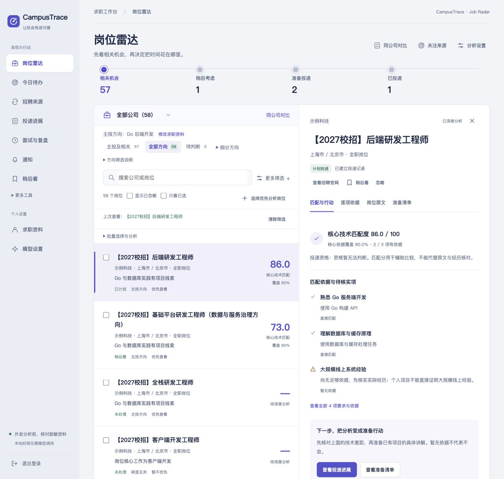
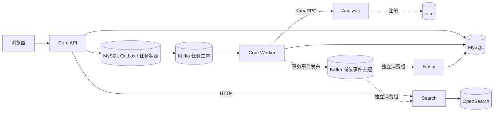

# CampusTrace

**CampusTrace 是一个 Go 校招求职工作台，用来比较岗位、安排投递，并根据每次投递留存的材料准备面试。**

**中文** | [English](README_EN.md) · [本地演示](#五分钟体验) · [架构](#架构与技术栈) · [工程验证](#质量验证)

```text
招聘观察 / 手动导入 → 搜索与岗位取舍 → 投递计划与材料留档
                                          ↓
下一次面试准备 ← 本地学习资料 ← 面试记录与复盘
```

1. **选岗与投递**。导入招聘信息，按公司和招聘批次比较岗位，在剩余名额内安排投递。到招聘官网提交后，在 CampusTrace 记录本次投递并留存当时的 JD 和简历。[申请流程](docs/application-journey.md)
2. **按本次申请准备面试**。从申请档案发起准备任务，Agent 根据留档材料、可用时间和已授权的复盘整理带依据的计划。用户可以补充约束、核对引用并确认保存。[准备指南](docs/preparation-first-run.md) · [界面截图](docs/verification/preparation-langgraph-20261101/acceptance-preparation-plan.png)
3. **把复盘留给下次**。核对招聘通知和面试安排后归档，面试复盘可以保存为带来源的学习笔记，供后续准备检索。[复盘与检索](docs/application-journey.md#提醒面试与复盘资料的联动)



*岗位雷达，截图使用合成数据。*

## 关键工程设计

| 实际问题 | 实现 | 验证入口 |
|---|---|---|
| 并发确认投递计划，且后续修改资料时仍能找回原稿 | MySQL 事务内复核名额、提交整组计划和快照，重复确认返回原回执 | [申请流程验收](docs/application-journey.md#验证与验收) |
| 批量导入触发慢任务，消息中断或重投后要能恢复 | 事务 Outbox 与 Kafka 分通道投递，MySQL 保存重试时间、执行租约和任务版本，持久化结果后提交消费位点 | [任务调度](docs/task-scheduling.md) · [Kafka 故障验收](docs/verification/kafka-tasks-20261101/README.md) |
| 面试计划要引用本次申请的材料，用户确认后才能保存 | LangGraph 编排检索、澄清和检查点恢复，Go 负责工具权限、模型预算、引用和版本复核、幂等保存 | [Go 与 LangGraph 分工](docs/preparation-langgraph.md) · [浏览器与持久化验收](docs/verification/preparation-langgraph-20261101/README.md) |
| 岗位变更要分别更新搜索和提醒 | 独立 Kafka 消费组处理同一岗位事件，通过索引版本和通知回执处理重放。启用 OpenSearch 时，Core 复核权限与数据版本，故障时有界回退到 SQL | [岗位事件](docs/job-events.md) · [搜索故障隔离](docs/search-resilience.md) |

更多后端设计见[工程证据索引](docs/engineering-evidence.md)，包括多 API 模型并发与预算控制、搜索诊断和索引重建。

## 架构与技术栈



- **Core**：Go、MySQL、Kafka、Redis；保存业务事实、权限、任务、投递留档与复盘。API 与 Worker 属于同一业务域。
- **Analysis**：独立 Go 进程，通过 [KanaRPC](https://github.com/KanaDoodle/KanaRPC) 的 KNR2 协议及 etcd 提供分析，支持远端取消、有界调度、发现驱动的连接复用与优雅关闭。固定依赖公开提交对应的 Go 版本，不需要相邻源码仓库；见[依赖说明](docs/dependency-audit.md)与[迁移验收](docs/kanarpc-migration.md)。
- **Search / Notify**：Search 只维护 OpenSearch 派生索引；Notify 独立消费，但属于 Core 业务域并共享其数据库。OpenSearch 按需开启。
- **申请准备 Agent**：Python / LangGraph 状态图、持久 SQLite Checkpointer；Go 提供受控工具、模型预算和确认保存，支持澄清、反馈修订与恢复。[使用与部署](docs/preparation-langgraph.md)。[项目答辩练习](docs/project-defense.md)支持对照当前代码核对回答、阅读后复述与确认保存复习计划；已确认经历可跨练习使用。[离线策略实验](docs/defense-strategy-optimization.md)复用轨迹和评测，保留失败、退化与人工审阅结果。
- **观测与回归**：OpenTelemetry、Prometheus/Grafana/Tempo、pprof、k6、Go race/fuzz、GitHub Actions。
- **AI 应用**：持久任务、受控工具调用、固定可恢复工作流、MCP；本地 BM25，按需配置 Embedding/RRF/Reranker。模型与检索效果通过独立评测记录。

默认部署启用 Core、MySQL、Kafka、Notify、Redis、etcd 与一个 Analysis 实例。RPC 双实例验收通过 `compose.rpc-pair.yml` 另行启用。默认用 MySQL 搜索，Notify 通过 Kafka 消费岗位变更。启用独立 Search 后，它用独立消费组接收同一批岗位变更。完整观测栈按需启用。

## 快速启动

需要 **Go 1.27.3+、Git、Docker 与 Compose**；首次构建需下载依赖和镜像。

```sh
git clone https://github.com/KanaDoodle/CampusTrace.git
cd CampusTrace
./campustrace start --open
```

打开 [127.0.0.1:8080](http://127.0.0.1:8080/)，注册账号后，按“求职资料 → 招聘来源 / 手动导入 → 岗位雷达 → 投递进展 → 面试与复盘”使用。从自己的求职资料和岗位开始，也可使用下方演示熟悉流程。

初次了解面试准备助手，可先看 [15分钟流程入门](docs/preparation-first-run.md)，按申请材料、计划、反馈和保存认识一条完整业务链。

```sh
./campustrace status
./campustrace doctor
./campustrace logs api --tail 100
./campustrace backup               # 备份到本机 bin/backups/
./campustrace restart --build      # 源码更新后备份、构建并重启
./campustrace stop                 # 停应用，保留依赖与数据
./campustrace stop --all           # 依赖也停止，数据卷保留
```

CLI 使用固定 Compose 项目名 `campustrace`，本地配置在 ignored `.env`。其他环境应使用独立的 32 字节以上 `JWT_SECRET`。恢复步骤见[备份与恢复](docs/recovery.md)。

## 五分钟体验

演示环境预置合成岗位与比较结果，使用独立的临时 MySQL/Redis/Kafka。可以体验从选岗到复盘的流程，无需模型密钥。配置模型并生成准备计划的步骤见[面试准备指南](docs/preparation-first-run.md)。

```sh
sh scripts/journey-local.sh demo
# 另一个终端执行自动 HTTP 验收；需使用刚启动、尚未修改的演示
python3 scripts/smoke-journey.py
```

演示地址为 `http://127.0.0.1:23380`，账号 `demo@campustrace.invalid`，密码 `Synthetic2026!`。自动验收覆盖导入与搜索、限投计划、材料冻结、通知确认及改期、复盘入库、学习笔记与下一次准备。退出演示进程后仅清理它拥有的临时依赖。

也可直接执行 `sh scripts/journey-local.sh smoke` 完成一次性验收。端口已使用时设置 `JOURNEY_HTTP_PORT`；演示不读取业务 `.env` 或现有数据卷。前端与实际操作见[申请闭环](docs/application-journey.md)。

## 质量验证

```sh
export GOWORK=off
go build ./...
go vet ./...
go test -race -count=1 ./...
node --test web/*.test.cjs
make verify-boundary
make performance-test
```

| 范围 | 可复现记录 |
|---|---|
| 版本验收 | [完整流程、固定版本与验收入口](docs/verification/release-20261101/README.md) |
| 岗位搜索诊断 | [1,000 / 5,000 / 10,000 岗位、Trace/EXPLAIN/pprof、冻结前后源码](docs/verification/search-diagnosis-20261031/README.md) |
| 故障恢复等待 | [A/B/B/A 短时对照、原始失败与全部分位数](docs/verification/search-recovery-20261031/README.md) |
| 技术要求解析 | [历史片段、合成控制、RPC 版本与旧缓存/代际隔离](docs/verification/technology-requirements-20261031/README.md) |
| 模块串联与精简 | [申请与复盘联动](docs/verification/linkage-20261031/README.md)、[精简修复](docs/verification/redundancy-fixes-20261031/README.md) |

各报告记录工作负载、运行环境、源码版本、完整分位数和原始结果。性能回归、规则解析与模型效果采用各自的评测口径，详见[性能验收](docs/performance.md)与[Agent 评测](docs/agent-evaluation.md)。

## 按需运行

| 命令 | 说明 |
|---|---|
| `make search-stack` | 在默认岗位通知上启用[独立 Search](docs/search-service.md) |
| `make observability` | [观测栈、指标与本地告警](docs/operations.md#可选的完整观测栈) |
| `make resilience-test` | 隔离的真实 HTTP / SQL / OpenSearch 故障验收 |
| `make kafka-test` | 隔离 Kafka 消费、重放与恢复验收 |
| `make performance` | [k6 性能回归](docs/performance.md) |

## 文档导航

- [岗位匹配与个人资料](docs/matching.md)：完整材料分析、公司内比较、限投、外发预览与缓存。
- [申请闭环](docs/application-journey.md)：计划、留档、面试通知、改期、复盘与下一次准备。
- [学习资料检索](docs/knowledge-retrieval.md)与[求职助手](docs/agent-harness.md)：本地笔记、受控工具与恢复，语义检索按需开启。
- [招聘来源清单](docs/campus-source-inventory.md)：按来源标注自动导入范围、官网入口和访问状态。
- [架构](docs/architecture.md)、[接口](docs/api.md)、[运行与排障](docs/operations.md)、[归档实验](experiments/README.md)。

## 使用与数据处理

- 投递计划、材料留档和站内提醒在 CampusTrace 中管理，实际投递通过招聘官网完成。
- 简历支持在浏览器本地读取 PDF、DOCX、TXT；扫描件请先转换为文字。简历整理、岗位分析和语义索引提供外发内容预览，确认后发送给所选模型。
- 原始简历、API 密钥和数据库备份属于私密数据，请存放在公开仓库之外。配置与恢复步骤见[运行说明](docs/operations.md)和[备份恢复](docs/recovery.md)。

许可证：[AGPL-3.0](LICENSE)。
