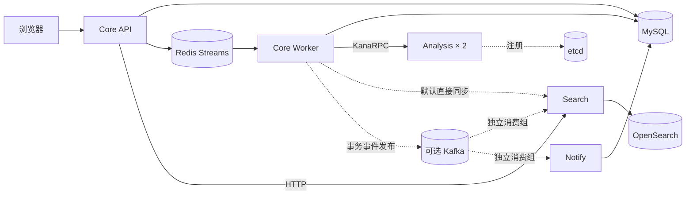
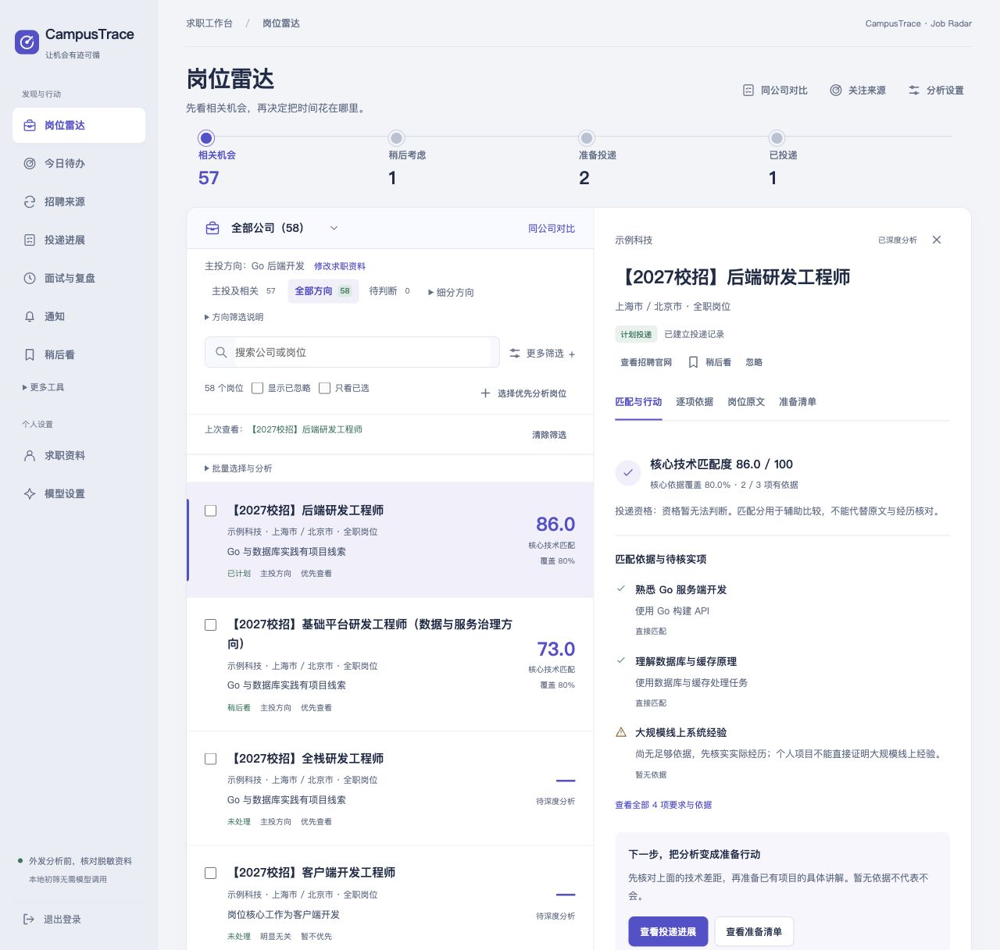

# CampusTrace

**Go 编写的个人校招求职工具：记录招聘变化、挑选岗位、跟进投递，把面试复盘用于下一次准备。**

**中文** | [English](README_EN.md) · [架构](docs/architecture.md) · [工程证据](docs/engineering-evidence.md) · [收尾验收](docs/verification/release-20261031/README.md)

```text
招聘观察 / 手动导入 → 搜索与岗位取舍 → 投递计划与材料留档
                                          ↓
下一次面试准备 ← 本地学习资料 ← 面试记录与复盘
```

项目同时保留原文、候选证据和规则判断。招聘状态、本人资格、岗位相关性分别核对；相似度和规则分数不作为录用概率。模型阅读完整 JD 与已确认的个人材料，发送前由用户检查外发预览。

## 三条后端主线

| 实际问题 | 实现 | 验证入口 |
|---|---|---|
| 岗位写入后搜索、通知需要分别追平，重复事件不能重复生效 | MySQL 事务 Outbox、Kafka 独立消费组、索引版本与通知回执；Redis 继续调度任务 | [岗位事件](docs/job-events.md)：确认丢失、独立停机恢复、重放与删除 |
| Search 故障后仍需权限正确地查询，不能把压力无界转给 MySQL | 前台/远程并发隔离、单个有界后台恢复探测、SQL 回退预算与有界等待；Core 复核 ACL、版本、哈希与代际 | [搜索故障隔离](docs/search-resilience.md)、[Trace / EXPLAIN / pprof 诊断](docs/verification/search-diagnosis-20261031/README.md) |
| 多 API 竞争模型名额，进程中断后无法确认是否已执行或计费 | 公平许可、原子调用预算、执行账本、UNKNOWN 与人工核对、迟到结果隔离 | [模型执行控制](docs/model-control.md)：多进程竞争、强杀与恢复 |

此外，申请材料按次冻结，复盘可以保存为带来源的学习笔记，再被同一申请的准备任务检索。技术要求解析保留 C++ 字面量，区分必需、优先与任选，Analysis RPC 语义版本防止旧结果进入新缓存。

## 架构与技术栈



- **Core**：Go、MySQL、Redis；保存业务事实、权限、任务、投递留档与复盘。API 与 Worker 属于同一业务域。
- **Analysis**：独立 Go 进程，通过 [KanaRPC-Go](https://github.com/KanaDoodle/KanaRPC-Go) 的公开接口及 etcd 提供分析。固定依赖已发布版本，不需要相邻源码仓库；上游来源见[依赖说明](docs/dependency-audit.md)。
- **Search / Notify**：Search 只维护 OpenSearch 派生索引；Notify 独立消费，但属于 Core 业务域并共享其数据库。完整栈按需开启。
- **观测与回归**：OpenTelemetry、Prometheus/Grafana/Tempo、pprof、k6、Go race/fuzz、GitHub Actions。
- **AI 应用**：持久任务、受控工具调用、固定可恢复工作流、MCP；本地 BM25，按需配置 Embedding/RRF/Reranker。真实模型效果仍需另外评测。

默认部署启用 Core、MySQL、Redis、etcd 与两个 Analysis 实例；Search、Kafka 和完整观测栈为可选组件。

## 快速启动

需要 **Go 1.25.9+、Git、Docker 与 Compose**；首次构建需下载依赖和镜像。

```sh
git clone https://github.com/KanaDoodle/CampusTrace.git
cd CampusTrace
./campustrace start --open
```

打开 [127.0.0.1:8080](http://127.0.0.1:8080/)，注册账号后，按“求职资料 → 招聘来源 / 手动导入 → 岗位雷达 → 投递进展 → 面试与复盘”使用。启动不会自动导入样例岗位。

```sh
./campustrace status
./campustrace doctor
./campustrace logs api --tail 100
./campustrace backup               # 备份到本机 bin/backups/
./campustrace restart --build      # 源码更新后备份、构建并重启
./campustrace stop                 # 停应用，保留依赖与数据
./campustrace stop --all           # 依赖也停止，数据卷保留
```

CLI 使用固定 Compose 项目名 `campustrace`，本地配置在 ignored `.env`。其他环境应使用独立的 32 字节以上 `JWT_SECRET`。恢复步骤见[备份与恢复](docs/recovery.md)。

## 五分钟合成演示

演示只使用临时 MySQL/Redis、虚构账号和预置比较结果，不调用外部模型或招聘站点。

```sh
sh scripts/journey-local.sh demo
# 另一个终端执行自动 HTTP 验收；需使用刚启动、尚未修改的演示
python3 scripts/smoke-journey.py
```

演示地址为 `http://127.0.0.1:23380`，账号 `demo@campustrace.invalid`，密码 `Synthetic2026!`。自动验收覆盖导入与搜索、限投计划、材料冻结、通知确认及改期、复盘入库、学习笔记与下一次准备。退出演示进程后仅清理它拥有的临时依赖。

也可直接执行 `sh scripts/journey-local.sh smoke` 完成一次性验收。端口已使用时设置 `JOURNEY_HTTP_PORT`；演示不读取业务 `.env` 或现有数据卷。前端与实际操作见[申请闭环](docs/application-journey.md)。



## 验证与证据

```sh
export GOWORK=off
go build ./...
go vet ./...
go test -race -count=1 ./...
node --test web/*.test.cjs
make verify-boundary
make performance-test
```

| 范围 | 可复现记录 |
|---|---|
| 当前发布收尾 | [完整流程、固定版本与验收入口](docs/verification/release-20261031/README.md) |
| 岗位搜索诊断 | [1,000 / 5,000 / 10,000 岗位、Trace/EXPLAIN/pprof、冻结前后源码](docs/verification/search-diagnosis-20261031/README.md) |
| 故障恢复等待 | [A/B/B/A 短时对照、原始失败与全部分位数](docs/verification/search-recovery-20261031/README.md) |
| 技术要求正确性 | [历史片段、合成控制、RPC 版本与旧缓存/代际隔离](docs/verification/technology-requirements-20261031/README.md) |
| 模块串联与精简 | [申请与复盘联动](docs/verification/linkage-20261031/README.md)、[精简修复](docs/verification/redundancy-fixes-20261031/README.md) |

性能数字对应各报告内的归档源码和本机合成条件，不能解释成线上吞吐或 SLA。恢复探测移出前台后，部分 p95/p99 仍有波动，原始数据保留。规则控制通过数、离线 Agent 回归均不代表真实模型准确率。

## 按需运行

| 命令 | 说明 |
|---|---|
| `make search-stack` | [独立 Search](docs/search-service.md) |
| `make kafka-stack` | [岗位事件与独立消费](docs/job-events.md) |
| `make observability` | [观测栈、指标与本地告警](docs/operations.md#可选的完整观测栈) |
| `make resilience-test` | 隔离的真实 HTTP / SQL / OpenSearch 故障验收 |
| `make kafka-test` | 隔离 Kafka 消费、重放与恢复验收 |
| `make performance` | [k6 性能回归](docs/performance.md) |

## 功能说明与边界

- [岗位匹配与个人资料](docs/matching.md)：完整材料分析、公司内比较、限投、外发预览与缓存。
- [申请闭环](docs/application-journey.md)：计划、留档、面试通知、改期、复盘与下一次准备。
- [学习资料检索](docs/knowledge-retrieval.md)与[求职助手](docs/agent-harness.md)：本地笔记、受控工具与恢复，语义检索按需开启。
- [招聘来源清单](docs/campus-source-inventory.md)：链接不代表已实现自动抓取；网站改版、登录或验证码可能阻止导入。
- [架构](docs/architecture.md)、[接口](docs/api.md)、[运行与排障](docs/operations.md)、[归档实验](experiments/README.md)。

不提供自动投递；通知以站内提醒为主。扫描简历未支持 OCR，复杂语义需核对。没有生产流量、独立人工金标准上的模型效果或多节点高可用证明。原始简历、API 密钥与数据库备份不应进入公开仓库。

许可证：[AGPL-3.0](LICENSE)。
