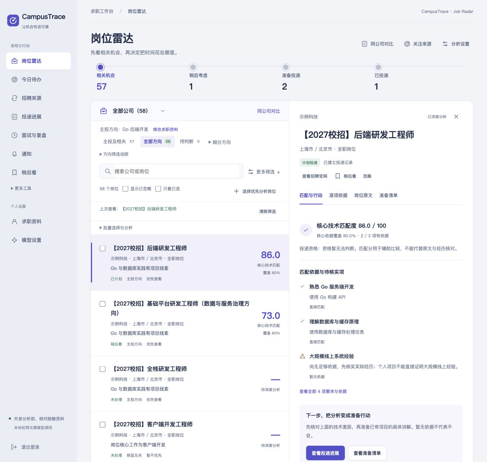

# CampusTrace

**CampusTrace is a Go-based workspace for comparing graduate roles, planning applications, and preparing for interviews with the materials saved for each submission.**

[中文](README.md) | **English** · [Local demo](#explore-the-workflow) · [Architecture](#architecture) · [Verification](#verification)

```text
Sources / manual imports → Search and role selection → Application plans and frozen materials
                                                               ↓
Next interview preparation ← Local study notes ← Interview records and reviews
```

1. **Compare roles and plan applications.** Import openings, compare roles by company and hiring round, and plan within the remaining application quota. After applying on the employer's site, record the submission with a snapshot of the job description and resume. [Application journey](docs/application-journey.md)
2. **Prepare for a specific interview.** Start from the application dossier. The agent uses the saved materials, available time and authorized reviews to draft a plan with sources. Review its citations, refine the constraints and confirm the save. [Preparation guide](docs/preparation-first-run.md) · [Screenshot](docs/verification/preparation-langgraph-20261101/acceptance-preparation-plan.png)
3. **Keep interview reviews for later.** Attach confirmed recruiting notices and schedules to the application, then save interview notes with their source so later preparation tasks can retrieve them. [Notes and retrieval](docs/application-journey.md#提醒面试与复盘资料的联动)



*Job radar with synthetic data.*

## Key engineering designs

| Problem | Implementation | Evidence |
|---|---|---|
| Confirm application plans concurrently and preserve the original materials | Recheck quota inside a MySQL transaction, commit the entire plan and snapshots together, and return the original receipt on repeat confirmation | [Application acceptance](docs/application-journey.md#验证与验收) |
| Keep bulk imports responsive and recover interrupted or redelivered tasks | Transactional outbox and separate Kafka task lanes. MySQL stores retry times, execution leases and task revisions. Consumers commit offsets after persisting the outcome | [Task scheduling](docs/task-scheduling.md) · [Kafka failure tests](docs/verification/kafka-tasks-20261101/README.md) |
| Ground an interview plan in the application dossier and save it with user approval | LangGraph routes retrieval, clarification and checkpoint recovery. Go enforces tool access, model budgets, citations, material versions and idempotent saves | [Go and LangGraph](docs/preparation-langgraph.md) · [Browser and persistence checks](docs/verification/preparation-langgraph-20261101/README.md) |
| Update search and reminders independently when a job changes | Independent Kafka groups consume job events. Index versions and notification receipts handle replay. With optional OpenSearch enabled, Core checks permissions and versions and bounds the SQL fallback on failure | [Job events](docs/job-events.md) · [Search failure isolation](docs/search-resilience.md) |

The [engineering evidence index](docs/engineering-evidence.md) also covers shared model capacity and budgets across API processes, search profiling, and online index rebuilds.

## Architecture

- **Core API / Worker:** Go, MySQL, Kafka and Redis. Owns authoritative records, authorization, task scheduling and the application workflow.
- **Analysis:** separate Go processes, discovered through etcd and called through the public [KanaRPC](https://github.com/KanaDoodle/KanaRPC) APIs over KNR2, with remote cancellation, bounded scheduling, discovery-driven connection reuse and graceful drain. The module pins a public commit using a Go pseudo-version; no sibling checkout is required. See [dependency provenance](docs/dependency-audit.md) and [migration acceptance](docs/kanarpc-migration.md).
- **Optional Search:** independent HTTP service owning only the derived OpenSearch index. Core retains permission and content checks.
- **Job-event consumers:** Notify is enabled in the base stack. Optional Search uses an independent consumer group. Notify remains in the Core business domain and shares its SQL database.
- **Interview preparation agent:** Python and LangGraph for conditional routing and clarification, with persistent SQLite checkpoints. Go owns authorization, frozen materials, retrieval, model budgets, validation and confirmed saves. [Deployment and recovery](docs/preparation-langgraph.md)
- **Observability and regression:** OpenTelemetry, Prometheus/Grafana/Tempo, pprof, k6, race/fuzz checks and GitHub Actions.
- **AI application backend:** persistent tasks, controlled tools, resumable reviewed workflows and MCP; local BM25 with optional Embedding/RRF/Reranker. Model and retrieval results have dedicated evaluation workflows.

The [Chinese README](README.md#架构与技术栈) includes the service diagram. Default deployment starts Core, MySQL, Kafka, Notify, Redis, etcd and one Analysis instance. The `compose.rpc-pair.yml` override adds a second instance for discovery and failover checks. It uses MySQL for job search. The optional Search stack adds OpenSearch indexing from the same Kafka job events.

## Start

Requirements: **Go 1.27.3+, Git and Docker with Compose**. The first build downloads modules and images.

```sh
git clone https://github.com/KanaDoodle/CampusTrace.git
cd CampusTrace
./campustrace start --open
```

Open [127.0.0.1:8080](http://127.0.0.1:8080/) and register an account. The UI is in Chinese. Start with profile, source/manual import, job radar, applications, and interviews/reviews. Start with your own materials and roles, or explore the demonstration below.

```sh
./campustrace status
./campustrace doctor
./campustrace logs api --tail 100
./campustrace backup
./campustrace restart --build
./campustrace stop                 # Stop apps; preserve dependencies and data
./campustrace stop --all           # Stop dependencies too; preserve volumes
```

The CLI uses the fixed Compose project `campustrace`. Local settings live in the ignored `.env`. Use a separate JWT secret of at least 32 bytes outside local use. See [backup and recovery](docs/recovery.md).

## Explore the workflow

```sh
sh scripts/journey-local.sh demo
# In another terminal, against the fresh unmodified demo:
python3 scripts/smoke-journey.py
```

Demo: `http://127.0.0.1:23380`, account `demo@campustrace.invalid`, password `Synthetic2026!`. It owns disposable SQL/Redis/Kafka dependencies, uses fictional data and a pre-seeded comparison, and makes no external model/source calls. Exiting removes only its temporary dependencies.

For model configuration and live plan generation, see the [interview preparation guide](docs/preparation-first-run.md).

Alternatively, `sh scripts/journey-local.sh smoke` runs acceptance and exits. Set `JOURNEY_HTTP_PORT` for a different port. The HTTP scenario covers import/search, atomic application planning, frozen submissions, notice confirmation/rescheduling, review-to-note import, and retrieval for later preparation.

## Verification

```sh
export GOWORK=off
go build ./...
go vet ./...
go test -race -count=1 ./...
node --test web/*.test.cjs
make verify-boundary
make performance-test
```

- [Release acceptance](docs/verification/release-20261101/README.md): end-to-end scenario and verification entry points.
- [Search diagnosis](docs/verification/search-diagnosis-20261031/README.md): 1,000/5,000/10,000 synthetic jobs, trace/SQL/profile evidence and frozen sources.
- [Recovery probes](docs/verification/search-recovery-20261031/README.md): paired short runs, complete quantiles, failures and excluded host-interfered attempts.
- [Technical requirements](docs/verification/technology-requirements-20261031/README.md): historical excerpts, synthetic controls, RPC semantics and cache/generation fencing.
- [Workflow linkage](docs/verification/linkage-20261031/README.md) and [simplification](docs/verification/redundancy-fixes-20261031/README.md).

Each report records its workload, environment, source revision, complete quantiles and raw results. Performance regression, rule parsing and model quality use separate evaluation criteria; see [performance acceptance](docs/performance.md) and [Agent evaluation](docs/agent-evaluation.md).

## Further reading

[Application journey](docs/application-journey.md) · [Matching](docs/matching.md) · [Knowledge retrieval](docs/knowledge-retrieval.md) · [Agent](docs/agent-harness.md) · [Sources](docs/campus-source-inventory.md) · [Operations](docs/operations.md) · [API](docs/api.md) · [Archived experiments](experiments/README.md).

Optional stacks: `make search-stack` and `make observability`. Disposable acceptance: `make resilience-test`, `make kafka-test`, `make performance`.

## Usage and data handling

- Manage plans, frozen application materials and in-app reminders in CampusTrace; submit applications through recruiting websites.
- Read PDF, DOCX and TXT resumes locally in the browser. Convert scanned documents to text first. Resume extraction, job analysis and semantic indexing provide outbound previews before confirmed model calls.
- Keep resumes, API keys and database backups outside the public repository. See [operations](docs/operations.md) and [backup and recovery](docs/recovery.md) for deployment and data management.

License: [AGPL-3.0](LICENSE).
