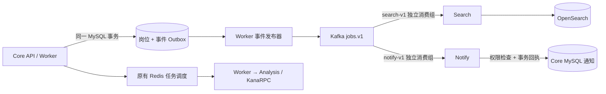

# 岗位变更事件：Kafka、Search 与通知

## 解决的问题

同一份岗位资料更新后，搜索索引和用户通知需要分别处理。Search 暂停不应让通知停止；通知失败也不应阻止搜索追平。Kafka 在这里分发岗位变更，原有抓取、分析、延迟重试和公平调度继续使用 Redis Stream/ZSET，不迁移任务队列。



Notify 是独立进程，属于 Core 业务域，使用 Core 数据库进行权限检查、通知和去重回执事务；它还不是拥有独立数据库的完整业务服务。Search 仍只接收派生岗位文档，不连接 Core MySQL/Redis。

## 启动与切换

已有数据先备份。停止当前项目的 API/Worker，再在同一 Compose 项目中切换，避免新旧 Worker 同时写入。这里的 `make` 目标沿用 Compose 默认项目名；CLI 的固定项目名为 `campustrace`，如使用过 CLI，应设置 `COMPOSE_PROJECT_NAME=campustrace` 并先 `./campustrace stop`。不要把不同项目重复接到同一数据卷。

```sh
export COMPOSE_PROJECT_NAME=campustrace  # 如果平时通过 CLI 启动
make kafka-stack
make kafka-status
```

`compose.kafka.yml` 叠加基础、App 和 Search 配置，启用 `JOB_EVENTS_MODE=kafka`、Kafka、一次性 topic 初始化和 Notify。普通 `./campustrace start` / `make search-stack` 仍是直接同步模式，**不要用它们重启已切换的 Kafka 部署**；Kafka 模式用 `make kafka-stack` 和 `make kafka-stop` 管理。停止命令保留数据卷。回切时先停 Kafka 模式的 API/Worker/Search/Notify，再启动直接模式；未发布事件保留在 SQL 中，回切不会把历史通知转换为原来的扫描通知。

| 配置 | 默认值 / 语义 |
| --- | --- |
| `JOB_EVENTS_MODE` | `direct`；API 和 Worker 必须一起切到 `kafka` |
| `KAFKA_BROKERS` | Kafka 模式必填，逗号分隔的 `host:port` |
| `KAFKA_JOB_TOPIC` | `campustrace.jobs.v1` |
| `KAFKA_DLQ_TOPIC` | `campustrace.jobs.dlq.v1` |
| `KAFKA_SEARCH_GROUP` | `campustrace-search-v1`，仅 Search 使用 |
| `KAFKA_NOTIFY_GROUP` | `campustrace-notify-v1`，仅 Notify 使用 |
| `NOTIFY_METRICS_ADDR` | `127.0.0.1:18084`，Compose 中监听内部网络 |

Topic 默认三分区、七天保留、单条上限 1 MiB。生产者使用 `acks=all` 和 franz-go 默认幂等生产；Compose 是 **单 Kafka 4.4.0 KRaft 节点、单副本**，这些设置不提供集群高可用。Kafka/OpenSearch 不发布宿主机端口，Kafka 使用内部网络 PLAINTEXT；跨主机的认证、TLS 和多副本部署尚未实现。

## 事件、事务与顺序

迁移 `018_job_events.sql` 增加不可变事件记录、通知回执和通知版本表。启用 Kafka 后，岗位业务写入、最新搜索投影、搜索脏记录和事件在同一 MySQL 事务提交。数据库写入失败则全部回滚；接口不等待 Kafka。SQL 中未发布事件达到 100,000 条时，新的岗位变更明确返回过载错误，不静默丢弃。

事件 schema v1 包含稳定 `event_id`、`created/updated/deleted`、字段变化类别、时间、W3C traceparent 和完整派生岗位快照。仅文档哈希变化才产生新版本。新事件带全局单调版本，Kafka key 为 `dataset/job_id`，同岗位进入同一分区；不承诺跨岗位的消费顺序。删除以保留版本的 tombstone 表示。直接 SQL 删除只能由定期对账发现，不等同于受支持 API 的事务保证。

事件只包含岗位/JD 派生数据，不包含简历、项目事实、模型密钥或完整观察附件。私有岗位仍是敏感数据，Kafka 与 SQL 事件历史属于受信任的部署边界。启用前已有岗位不自动生成历史业务通知；搜索仍由最新投影回填。

Worker 中的发布器使用数据库连接级锁串行发送待发布事件。先获得 Kafka 确认，再标记 SQL `published_at`。确认丢失、进程中断或部分批次成功后会重投；SQL、Kafka、OpenSearch 没有一个共享事务，因此整体是 **至少一次投递 + 幂等效果**，不是跨系统 exactly-once。

## Search 的确认边界

Kafka 生产确认只表示消息已存入 broker。Core 的 `search_outbox` 仍保留到 Search 确认相应版本已经刷新、可以被查询：

1. Search 独立消费组把事件写入 OpenSearch，外部版本控制拒绝旧版本覆盖，同版本不同哈希报冲突。
2. Core 用 `/v1/applied` 检查指定索引 generation、文档版本和哈希；查询实际搜索可见的数据，而非实时 GET。
3. 只有确认满足时，才按对应版本清理脏记录。尚未追平时继续基础回退，并保留原有 Core ACL、哈希和版本复核。

重建索引使用带目标 generation 的 `snapshot` 事件，通过同一个 Kafka topic 分发；旧 generation 快照被跳过。快照只修复投影，不产生业务通知。投递成功后但消费尚未完成的同批快照最多每五秒重发一次；断线/重启后允许重复。

## 通知与失败处理

Notify 的组独立提交 offset，事务写入 `job_notification_receipts`、每岗位已处理版本与通知。批次发生错误时不确认 offset，关闭旧消费会话并从已确认位置重试，防止越过失败批次。SQL 回执和现有通知唯一键共同防止重投生成重复提醒。

只有与 Core 当前文档一致的最新事件生成提醒；延迟的旧变化记为已处理，不补发已经过时的历史提示。私有岗位只通知当前所有者；公共岗位通知已收藏、已有投递、或启用了对应来源关注的用户，忽略的岗位不通知。每次重新检查岗位权限，提醒文案来自 Core 当前资料，不信任事件中的文本。单事件最多 1,000 名收件人，超限事务回滚并重试，需人工调整范围或扩展分批 fanout，不截断后确认。

Kafka 模式关闭原先定时扫描的 `JOB_STATUS_CHANGED` 生成路径，改用岗位事件。优先级、截止时间、面试等时间驱动提醒仍使用原逻辑。删除事件推进消费并保留回执，不生成新增/资料更新提醒。当前通知是站内通知，没有接入邮件、短信或推送供应商。

无效 schema、格式或分区 key 的记录，先将来源 topic/partition/offset、SHA-256 和固定原因写入 DLQ，再提交源 offset。DLQ 不复制原始 JD/隐私正文。有效但暂时处理失败的业务事件保持重试，不直接丢入 DLQ；某个分区阻塞时可能连带该实例已分配的其他分区，独立消费组之间仍隔离。

## 回放与观测

```sh
make kafka-replay EVENT_ARGS='--from-version 0 --limit 1000'
```

回放把 SQL 中已发布的事件重新排队，保持原 ID，不清除消费回执。`--from-version` 是排他的全局版本游标；单次最多 10,000 条，输出最后版本，继续分页时使用该版本。它用于传输恢复/验证，**不会重发已经生成过的通知**。索引丢失优先使用 `search-rebuild`，由最新投影恢复；需要重做通知业务语义时应单独设计修复操作。

Kafka 保留七天后不能仅凭旧 offset 重放；SQL 事件历史当前不自动清理，应制定备份和保留策略。恢复旧数据库备份需协调 Kafka 消费组及 Search 索引状态，不能把旧 SQL、当前 offset 和当前索引拼接视为一致快照。

追加 `compose.observability.yml`、`compose.search-observability.yml`、`compose.kafka-observability.yml` 可观测完整部署。Kafka 面板显示发布积压、最早待发年龄、发布/消费速率和错误、DLQ、Notify 存活；消费速率不是 lag。实际各分区 lag 可用：

```sh
docker compose -f docker-compose.yml -f compose.app.yml -f compose.search.yml -f compose.kafka.yml exec kafka \
  /opt/kafka/bin/kafka-consumer-groups.sh --bootstrap-server kafka:9092 --describe --group campustrace-search-v1
```

同样查看 `campustrace-notify-v1`。异步链路沿持久化 traceparent 和 Kafka header 传播 trace；批量消费跨度以该批首个有效事件为父节点，不能把同批其他事件说成各自完整的消费 trace。监控不导出 JD、密钥或岗位 ID 标签。

## 复现验收

```sh
make kafka-test        # 真实 Kafka/OpenSearch + 隔离 MySQL/Redis/etcd，race 测试
make kafka-stack-test  # 实际 API/Worker/Search/Notify + 观测栈，自动清理
```

两个命令只拥有独立合成测试容器，不读 `.env`、不连接模型提供商、不使用已有业务卷。完整验收覆盖消费者独立暂停/恢复、broker 暂停时 Core 与 Redis 分析继续、恢复后追平、重放去重、毒消息 DLQ，以及真实 Tempo trace/Grafana 面板。本次结果与范围见下文。

## 共享工作区验证（2026-10-31）

在本机 Docker、Go 1.25.9、Kafka 4.4.0 和 OpenSearch 3.9.0 上使用隔离合成数据完成：

- `make kafka-test`：真实 broker 的独立消费组与失败批次重投；SQL 事务回滚；确认丢失后保留事件并重投；Search 未消费时不清理脏记录；两侧暂停/恢复；旧版本/删除标记；重建快照静默；通知收件人、权限、忽略和原状态扫描去重均通过。Go 测试启用 race。
- `make kafka-stack-test`：实际 API、Worker、Search、Notify、两个 Analysis 实例和观测组件启动。分别停止 Search/Notify，另一侧继续；暂停 Kafka 时合成岗位导入、读取与原 Redis 分析/评估完成；恢复后 SQL 待发记录和两个消费组 lag 归零。回放全部历史后站内提醒数量保持不变，两个组分别隔离一条毒消息，DLQ 不含原始正文。
- 真实 Tempo trace 覆盖 API、Worker、Search、Notify、Analysis 五种服务，共 145 个跨度；核对 Kafka 消费跨度的生产者父节点及敏感标记未进入 trace。Grafana 新事件面板 9 项通过读取验收。这是该次合成流程的观测结果，跨度数量不是质量或性能指标。
- 原直接模式 Search 回归通过，包括隔离、故障恢复、分页回填、确认丢失、旧确认保护、tombstone 和 HTTP 身份校验。
- 独立复跑全量 MySQL/Redis/etcd 集成测试：189 个顶层测试通过、8 个跳过；跳过项包含子进程入口、真实招聘网站及额外依赖案例，其中 Kafka / OpenSearch 用例已在上述专项实际运行。另有 pipeline / scheduling / recruitmentmail 共 24 个顶层测试通过。
- 默认 Go 测试、`go build ./...`、`go vet ./...`、`go test -race ./internal/...`、前端 444 项测试和公开依赖边界检查通过。KanaRPC 仍固定公开 v0.1.0，Search 未引入 Core MySQL/Redis/RPC 依赖。

首次重负载并行运行中，既有模型控制测试的 250ms 隔离期在断言前到期；不更改生产逻辑或放宽断言，单项复查及随后整套独立复跑均通过。首次全仓 race 还遇到共享工作区正在修改的 Agent 后端选择测试失败；该路径完成后单项与全仓 race 复查通过。原失败与复查日志均保留，不能把短时间断言的稳定性视为已解决。

完整容器结果的精简副本见 [acceptance.json](verification/job-events-20261031/acceptance.json)，检查结果见 [checks.json](verification/job-events-20261031/checks.json)，Kafka 相关源文件的交付时哈希见 [SHA256SUMS](verification/job-events-20261031/SHA256SUMS)。原始本机日志与 trace 在 ignored `bin/verification/kafka-20261031/`；CI 已添加相同命令及证据上传，尚未宣称 GitHub Actions 已执行。

没有调用外部模型，没有使用真实求职数据；未测多 broker 故障、跨主机扩缩容或生产吞吐，不据此声明生产高可用、业务投递效果或模型质量。

## 提交前的独立复核

为避免 Kafka 提交依赖并行修改中的 Agent 功能，将本次暂存内容单独导出为干净副本。构建、vet、默认 Go 测试、internal 竞态检查、436 项前端测试、公开 KanaRPC v0.1.0 / Search 依赖边界及 `go mod tidy -diff` 均通过。

该副本重新运行 `make kafka-test` 与 `make kafka-stack-test`，四个 Kafka 顶层用例及完整容器故障验收通过；五种服务的 trace 本次有 144 个跨度。Kafka 测试显式创建自身数据库和受限账号，不依赖其他未提交的测试隔离改动。

本次发布复核结果见 [publish-checks.json](verification/job-events-20261031/publish-checks.json) 和 [publish-acceptance.json](verification/job-events-20261031/publish-acceptance.json)；原始日志保留在 ignored `bin/verification/kafka-20261031/publish-selected-tree/`。上节 444 项前端及全量数据库回归是共享工作区的历史记录，436 项是本次独立提交副本的前端结果。未宣称远端 CI 已执行。
