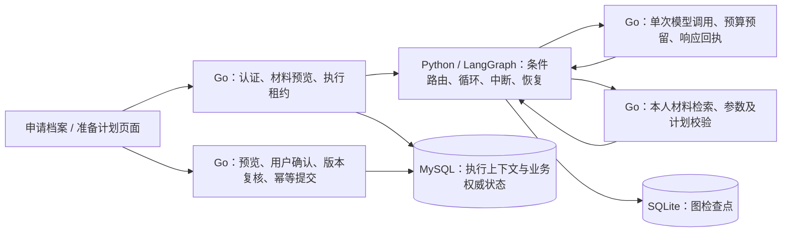

# 申请准备的 Go + Python / LangGraph 链路

申请档案中的 **生成面试准备计划** 与求职问答中的申请准备入口，默认都通过同一个 LangGraph 服务执行。普通问答、固定 Skills、岗位分析及其 KanaRPC 链路继续使用原职责。

## 职责与数据流



`services/preparation/graph.py` 具有 `materials / feedback / model / retrieve / validate / question / wait_input / wait_recovery` 节点。条件边根据模型返回的待执行动作、Go 校验反馈及终态选择下一步：检索可以改写再查，也可以在依据充分时直接生成。模型与读取节点各调用一次受控 Go 操作，Python 不调用 Go 的 `RunPreparationLoop`。

Go 保留模型适配器和上下文构造，便于继续使用网页配置、既有并发额度及预算回执。模型选择工具，LangGraph 控制节点循环与恢复；Go 的单步接口不自行启动下一轮。

| 保存位置 | 内容 | 权威范围 |
| --- | --- | --- |
| MySQL `agent_executions` | 审阅后的输入、消息、来源、模型派发意图与结果、工具回执、预算、计划、取消及租约 | 账号、业务事实、执行准入、结果及保存资格 |
| SQLite LangGraph Checkpointer | thread ID、节点游标、单步序号、待执行动作名、调用计数、通用等待标记、父子修订关联 | 图下一步及中断位置 |
| Redis / MySQL action receipt | 保存预览、确认动作、幂等回执 | 业务计划提交 |

图 thread ID 等于 Go execution ID。图检查点不保存凭据、模型消息、材料正文、完整计划或用户原始问题；这些继续只在 Go 业务库中保存。Python 的运行时 `Bridge` 上下文含一次性能力令牌，不进入图状态。LangSmith tracing 固定关闭，本轮没有外发到另一套追踪平台。

反馈经 Go 重新核对后创建独立修订：图从 `feedback` 节点载入本轮约束；澄清时，上版 `wait_input` 使用 `Command(resume=...)` 关联已确认的子修订，并结束旧图。旧 SQL 记录继续保留当时的问题，新版负责剩余计划。反馈不会被写成个人能力或历史面试事实。

## 安装、启动与停止

本轮本机与容器均验证 Python 3.14.7。主要依赖为 LangGraph 1.2.19、`langgraph-checkpoint-sqlite` 3.1.3、FastAPI 0.162.0、Uvicorn 0.54.0。`requirements.lock` 固定全部传递依赖和发行文件 SHA-256；不使用启动时自动升级。

```sh
# 正常 Compose 生命周期：构建 Go 与 Python 镜像，启动并检查 preparation
make run
./bin/campustrace status
./bin/campustrace logs preparation
make stop

# 本机开发：make dev-run 会安装锁定的 Python 依赖，并启动同一服务
make preparation-install
make dev-run
make dev-stop
```

Compose 的 `preparation` 服务只走内部网络，不发布宿主端口，单 Uvicorn worker。持久卷 `preparation-checkpoints:/data` 保存 SQLite 文件，停止/重建容器保留检查点。API 启动依赖该服务健康，CLI 的启停、日志、状态和失败清理均包含它。Go `/readyz` 仍表示业务依赖就绪；准备子系统可单独检查 `/internal/preparation/health`，避免把其他业务和准备服务混为一个健康结论。

本机开发默认配置：

```ini
PREPARATION_EXECUTOR=langgraph
PREPARATION_GRAPH_URL=http://127.0.0.1:18110
PREPARATION_GO_URL=http://127.0.0.1:8080
PREPARATION_SERVICE_TOKEN=local-preparation-service-change-this-2027
PREPARATION_CHECKPOINT_DB=var/preparation/checkpoints.sqlite
```

Compose 内部地址分别为 `http://preparation:18110` 和 `http://api:8080`。服务令牌在两个进程中保持一致；部署到共享环境时更换示例令牌。模型配置继续由网页或 Go 服务器提供，Python 无需模型 API Key。数据目录限制读写权限；SQLite 使用 WAL、文件持久化，适用于本轮单实例部署。多副本部署需要替换 Checkpointer 和线程并发控制，本轮不声称已验证该部署方式。

可单独启动 Python 排障：

```sh
services/preparation/.venv/bin/python -m uvicorn app:app \
  --app-dir services/preparation --host 127.0.0.1 --port 18110 \
  --workers 1 --no-access-log
curl --fail http://127.0.0.1:18110/healthz
```

健康响应核对实际图协议及框架版本，并访问 Checkpointer。服务缺失、协议版本不符、回调断连会明确失败或暂停，不会切到旧 Go 执行器。先查 `preparation` 日志、上述健康响应、两个进程的地址和令牌、持久卷权限，再从页面继续。模型结果 UNKNOWN 时，先核对提供商记录，再勾选授权新尝试；无需复制任务编号或操作 Python 控制台。

## 节点重放与边界

1. Go 每个活动尝试生成一个随机能力令牌，绑定账号、执行、租约、授权模型和工具；模型参数不能选择账号。内部接口仅接受 `action + sequence`，拒绝额外身份字段。
2. 每个完成操作保存单调单步序号。节点重放携带旧序号，Go 返回已持久化快照，不再次读取或调用模型。SQL 检查点失败不能作为成功回执。
3. 模型发送前，Go 保存预算预留与 DISPATCHED；返回结果及选定工具持久化后才推进序号。如果 Go 已保存响应但 Python 未写检查点，重放复用该响应。若派发后没有持久化结果，保持 UNKNOWN；重启不自动付费重试，必须由用户明确确认新尝试，未知调用的预算占用保留。
4. 已知返回的非法参数仍按原有限修正策略反馈给模型，计入模型/工具预算；这不是对 UNKNOWN 的重试。检索失败、无结果和引用错误同样以结构化反馈进入下一轮。
5. 读取意图已保存、结果未保存时可重读该只读操作，并计入预算。Python 不直接执行业务保存；确认保存仍在 Go 事务中复核账号、申请版本、来源身份、计划哈希和幂等回执。
6. 每次操作在 Go 复核版本和租约。取消先写 SQL 终态、撤销租约，再取消 Context；Python 监测调用方断连，取消图及回调，Go 回调又将断连传播给模型。迟到步骤没有权力覆盖取消或新尝试。跨进程网络不能撤回已经被提供商处理的请求，UNKNOWN 保留这一事实。
7. 图版本进入输入审阅哈希和执行版本；旧执行器的未完成记录在新主路径中只读，需要重新审阅建立任务。历史记录不改名为 LangGraph 运行。

节点恢复按 [LangGraph 中断文档](https://docs.langchain.com/oss/python/langgraph/interrupts) 的重新进入语义设计，`wait_input` 中断前没有业务副作用；文件检查点选型参照[持久化文档](https://docs.langchain.com/oss/python/langgraph/persistence)。本轮采用[状态图 API](https://docs.langchain.com/oss/python/langgraph/overview)，未引入多 Agent 或通用工作流编辑器。

## 演示

- **正常准备**：申请档案 → 生成面试准备计划 → 填 180 分钟、3 天 → 核对材料与外发范围 → 确认开始。查看岗位要求/一般建议、引用、时长及完成标准；保存预览后再次确认，刷新读取实际记录。
- **反馈与澄清**：将事项标为掌握或完成，填写“只剩一小时”或 15 分钟，核对新版。剩余项保留原 ID/标题，排除已完成项。时间或天数为零时出现澄清；补充后建立关联修订。
- **失败与恢复**：执行期间停止 Python 服务，页面显示中断和下一步；重启同一持久卷后继续。UNKNOWN 必须明确确认新尝试，已完成读取继续复用。取消后不提供保存路径；材料版本变化后重新核对建任务。

可复现的浏览器、真实 SQL 和跨进程故障演示使用合成材料与受控 HTTP 响应：

```sh
python3 scripts/verify-preparation-agent.py \
  --output /tmp/ct-langgraph-acceptance-new \
  --playwright-module /absolute/path/node_modules/playwright
```

脚本只创建和清理自己的容器、数据库、账号与进程，不操作现有业务数据。包括 Python 单独 SIGKILL、实际文件游标重读、丢失已知响应回包、不重复付费调用、澄清子修订、取消、版本失效、确认保存及回执核对。故障注入和结果未知保护是受控证据，不是线上故障恢复率。

## 测试、评测与语义审阅

```sh
make preparation-test
GOWORK=off go test -race ./internal/agent ./internal/transport ./internal/launcher ./cmd/preparation-eval
node --test web/*.test.cjs
python3 scripts/evaluate-preparation-langgraph.py --output /tmp/ct-langgraph-eval-new
```

继续使用原有 24 项合成任务，6 项调试、18 项保留验证；沿用的案例已参与之前调试，并非本轮新建的盲测留出集。受控对照的 dynamic 方案实际经过 Python / LangGraph；单次提示及固定检索综合仍为原 Go 基线。受控工具采用同一 BM25 与失败注入，验证路径与约束。`stale / unauthorized` 两项 CLI 案例是明确标记的前置条件控制，真正 SQL/HTTP 版本与账号行为另由验收检查。

真实模型评测仍通过 `cmd/preparation-eval -live`，需要明确模型配置、密钥环境变量、授权材料哈希与请求上限。专用 Python 评测进程的 `PREPARATION_GO_URL` 指向 CLI 回调端口；与产品进程分开数据目录和端口：

```sh
# 终端 A：独立评测服务，无模型凭据
PREPARATION_GO_URL=http://127.0.0.1:18112 \
PREPARATION_CHECKPOINT_DB=/tmp/ct-langgraph-private-eval/checkpoints.sqlite \
services/preparation/.venv/bin/python -m uvicorn app:app \
  --app-dir services/preparation --host 127.0.0.1 --port 18120 --no-access-log

# 终端 B：先用受控模型；真实调用另需 -live 及明确授权参数
GOWORK=off go run ./cmd/preparation-eval -split validation \
  -graph-url http://127.0.0.1:18120 -graph-callback-addr 127.0.0.1:18112 \
  -output /tmp/ct-langgraph-private-eval/validation.json
python3 scripts/review-preparation-evaluation.py \
  --report /tmp/ct-langgraph-private-eval/validation.json \
  --output /tmp/ct-langgraph-private-eval/semantic-review.json
```

CLI 不隐式读取网页密钥，不自动重置历史调用额度。完整输出和私人材料放仓库外。图版本、Prompt 哈希、工具版本、模型配置、调用与 Token、失败候选、无收益检索保留在报告中。新增 `retrieval_new_sources / retrieval_cited_sources` 只描述新来源及是否被引用，不能据此声称检索改善了答案。

语义审阅单独按 0/1/2 记录岗位要求覆盖、引用语义支持、工作量可完成性、反馈遵守、无虚构经历和额外检索价值。未审阅为 null，不用程序通过率代替。审阅文件绑定报告 SHA-256，填写审阅者与逐项证据，可用同一脚本 `--validate` 检查；结构校验不验证评分本身。当前助手审阅与独立人工标注必须分别注明。

## 旧执行器与迁移边界

产品默认为 LangGraph。`RunPreparationLoop` 只循环同一组受控单步函数，用于旧评测回归及显式回滚；没有复制两套模型、工具和校验规则。历史 CLI 需要显式 `-legacy-dynamic`；临时产品回滚使用 `PREPARATION_EXECUTOR=legacy` 并重启 API，日志会警告。如果 Python 不能启动，明确使用 `PREPARATION_EXECUTOR=legacy docker compose -f docker-compose.yml -f compose.app.yml up -d --no-deps api` 应用回滚配置；这是人工操作，不通过整栈健康检查掩盖依赖故障。没有失败后的自动降级，两个执行器的未完成任务不能互相接管。稳定后可移除产品回滚分支，保留历史报告。

本轮增加的两项小范围补强：用户进度与诊断分层；检索使用量及可绑定证据的语义审阅入口。框架迁移本身不表示质量提升。下一项优先工作是在相同授权材料与额度下完成新链路真实模型对照，并由独立审阅者检查短时计划工作量与引用支持。

本次本地运行与逐项证据见[迁移验收报告](verification/preparation-langgraph-20261101/README.md)。
