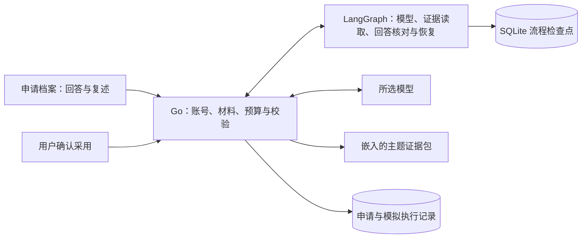

# 申请专属项目答辩

从这次申请的岗位要求、简历与项目材料出发，围绕已核对的当前项目证据练习解释实现。助手核对用户的原回答，选择补读、追问、复述或结束，并给出可以确认保存的小型复习计划。

## 使用

1. 投递进展 → 申请档案 → 练习讲清项目。也可从“生成面试准备计划”进入，在“准备方式”选择“练习讲清项目”。
2. 选择主题，先用自己的话回答；不熟悉时直接说明目前知道什么。首版提供 CampusTrace 的 Go／LangGraph 分工与模型未知结果恢复两个主题。
3. 点击“核对材料与调用范围”，分别查看本次申请留档、当前项目证据、这次问题和实际外发的回答。主题浏览与预览不调用模型。
4. 核对后开始。模型按证据索引选择读取，逐项反馈回答有依据、与证据不符、本次未说明或需要核对的内容。展开引用可查看出处；“有依据”描述本条回答，不自动表示已经掌握。
5. 按计划阅读一个片段，再在“阅读后复述或继续回答”中提交自己的说明和剩余时间。下一轮绑定上轮的问题、反馈及已完成的证据读取，按核对点展示前后反馈变化；每轮再次核对范围。
6. 点击“核对并保存计划”及“确认保存这版计划”，把待复习事项保存到这次申请的计划记录。结束且没有待办时不创建空计划。

每条连续练习最多四轮，换主题或开始新练习使用目标表单。模拟回答与反馈保存在执行记录，不自动写入个人能力、项目事实、长期记忆或真实面试复盘。遗忘记忆时沿用现有清理机制，连同执行上下文一起清除。

## 设计与数据流



复用申请准备的执行记录、单步回执、调用保护、取消、来源身份、租约及计划确认机制。Python 图增加 `review_answer` 节点；模型可以选择 `read_project_defense_evidence` 或 `finish_project_defense_review`，Go 一次只执行图请求的受控操作。产品路径不调用旧 Go 循环，不另建练习执行器或模型服务。

Go 检查核对点是否完整且唯一、回答引文是否来自本轮原回答、来源是否已读取并属于该核对点、引文是否逐字存在、时间与练习规模是否符合约束。阅读必须指向已读主题片段，短计划只安排阅读和口述。无效参数和引用返回给下一轮模型修正，保留被拒绝轨迹。

实际下一步和解释由模型生成。程序验证引用绑定与结构，语义支撑、教学质量及用户是否真正理解分别审阅，不能以程序通过或模型判断代替。

## 证据包与版本

`internal/projectdefense/catalog.json` 只包含脚本中固定白名单的源码与测试片段。每段记录文件位置、行号、片段及文件 SHA-256，整个包具有独立版本；核对点关联允许引用的来源。模型只能选择主题中的 ID，没有文件路径、URL、Shell 或任意仓库读取工具。

证据属于当前项目阅读资料，与原投递的 JD／简历／项目留档分开。`base_commit` 记录生成时的基线，工作区文件哈希标明实际内容；存在未提交改动时不冒充纯提交快照。测试源码用于解释检查意图，实际运行结果另行记录。

```sh
# 修改被引用文件后重新生成，并审阅新增或变化的片段。
python3 scripts/build-project-defense-evidence.py
python3 scripts/build-project-defense-evidence.py --check
```

CI 检查片段、位置及文件哈希与源码一致。下一轮输入与保存提案绑定证据版本；不匹配时拒绝继续或确认。执行中的旧结果沿用 SQL 租约和取消保护。检查点只保存图游标与操作状态，回答、材料、模型配置和凭据由 Go 管理；密钥不进入 Python 状态。

提示版本为 `project-defense-v1`，执行结果记录证据包版本；评测逐例记录实际系统提示哈希。首版是用户选主题、模型选择主题内证据和下一步，不宣称已能自动审阅任意仓库或诊断完整岗位能力。这里的证据读取是白名单片段查阅，不是向量检索效果实验。

## 启动与验证

沿用现有 `./campustrace start`，源码更新后执行 `./campustrace restart --build`，Go API 与 Python preparation 服务同步更新。没有新增依赖、服务、模型配置、数据库迁移或监听端口。模型不可用时保留明确失败或未知状态，不静默切换执行器。

```sh
GOWORK=off go test -race ./internal/agent -run 'TestProjectDefense|TestPreparation' -count=1
make preparation-test
node --test web/*.test.cjs

# 20个合成任务，实际跨 Go/Python/LangGraph，模型响应受控。
python3 scripts/evaluate-preparation-langgraph.py \
  --dataset internal/agent/testdata/project-defense-tasks.json --arms dynamic \
  --output /tmp/ct-project-defense-evaluation-new

# 实际 API、数据库、回执、浏览器与进程重启；仅创建自己的临时依赖。
python3 scripts/verify-preparation-agent.py \
  --output /tmp/ct-project-defense-product-new \
  --playwright-module /absolute/path/node_modules/playwright
```

任务集有6个调试案例、14个验证案例，均为合成控制，覆盖两主题、材料缺失、无基础回答、错误读取、引文纠正、5分钟预算、结束和未知响应。来源版本变化、账号隔离、确认保存、重启恢复由 API／SQL 验收检查，读取测试源码本身不算通过这些测试。响应分支是预设的程序验收，不计模型能力或学习提升成绩。

后续真实评测可复用 `cmd/preparation-eval -live -arms dynamic -dataset ...` 的模型配置与调用上限授权。除任务文件的 `-authorize-material-sha256` 外，必须通过 `-authorize-project-evidence-sha256` 明确授权本轮证据包哈希；缺失或不匹配时在模型请求前拒绝。该哈希可从主题接口的 `version` 或受控评测报告的 `project_evidence_sha256` 核对。

这条答辩评测只支持 LangGraph dynamic，其他方案明确拒绝，不伪装成可比的旧工作流。真实或脱敏回答、完整输出放在仓库外。原评测授权的120次调用预算已经用满，本轮没有调用真实模型；授权调用预算与提供商账户余额分别看待。具体实测、初次失败和证据范围见[验收记录](verification/project-defense-20261101/README.md)。

接下来优先验证一件事：用少量真实回答审阅误判和阅读任务规模，再请使用者阅读、换个问题复述。保存原回答与依据，才能判断反馈是否帮助补上遗漏；不以自评分数或复述相同参考答案替代学习效果。
