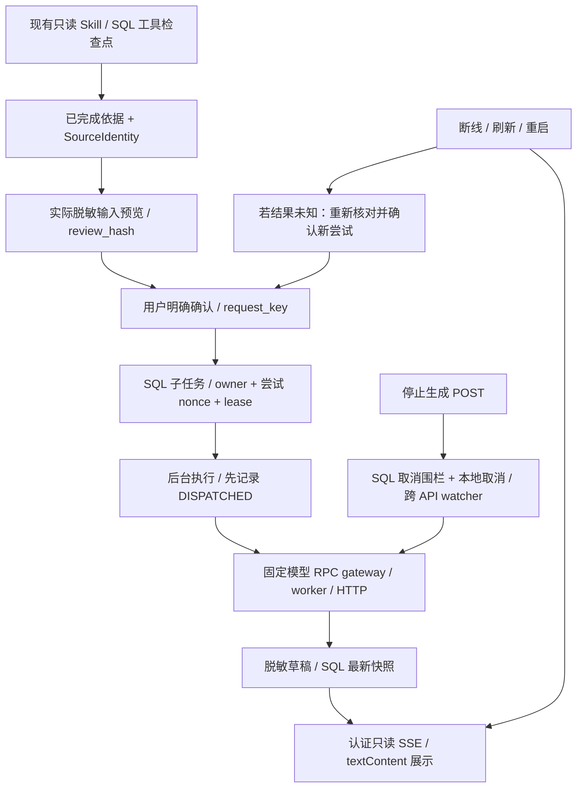

# M4 CampusTrace 与推理 RPC 的边界接入

后续：日常依据说明现默认直连模型 API；原有 RPC/vLLM 路径保留为显式实验后端。见[后端选择与验收](model-backends.md)。下文保留 M4 原始实现与验收边界；历史 fixture 结果不代表真实模型验证。

日期：2026-10-30—31。以两个项目当前未提交工作区为基线，备份 `/private/tmp/campustrace-before-m4.tgz` 与 `/private/tmp/KanaRPC-Go-before-m4.tgz`。保留搜索等既有修改，使用全新隔离测试服务，不操作现有业务数据库或容器。

状态：四阶段实现和本地验收完成；真实 vLLM / GPU / 模型质量验收未执行。结果与失败记录见 [验证报告](verification/rpc-agent-m4/report.md)。

2026-10-31 收尾：迁移、作用域隔离和独占恢复服务接入已补齐；新增 [版本化 SDK 接入](stream-sdk.md)与[收尾验证报告](verification/rpc-agent-m4/closeout/report.md)。下文 workspace 是开发模式；流式构建现在也支持独立版本模块消费，公开发布仍待完成。

## 分阶段实施

1. **持久任务与模型边界**：复用 AgentExecution 的 owner、nonce、lease、checkpoint、尝试上限和取消围栏。固定只读 skill 提供依据，用户预览脱敏的实际模型输入并确认，才创建独立说明子任务。逻辑任务与每次尝试均防重复；发送后中断按结果未知处理，再次生成需重新确认，不能自动重放。
2. **RPC 与执行控制**：服务器固定 gateway/model，文本流、总预算、输出上限、用户隔离 cache_salt；拒绝 model tool calls，不执行生成内容。后台执行与浏览器订阅分离；取消/遗忘/关闭传到 RPC、worker 和上游 HTTP。复用 SQL 租约恢复读取，进程重启后不自动调用模型。
3. **展示与恢复**：认证 SSE 只读取持久 checkpoint，重连不生成。展示未完成说明、来源和终态，文本安全渲染；切页/登出停止订阅，保留输入/滚动及审阅弹窗。继续须重新预览，未知结果须明确认可可能重复调用。
4. **端到端与回归**：隔离 MySQL/Redis/etcd；HTTP→CampusTrace→RPC gateway→worker→SSE fixture，验证流、取消、重连、重启恢复、owner/CSRF、重复、迟到完成、资料变更、遗忘和恶意输出。Go 普通/race/vet、Node 与浏览器检查，两个项目回归。真实 vLLM 缺失明确待验。

## 选择依据与发布边界

- 固定 skill 已持久化只读工具检查点；自由问答模型文本不直接成为业务事实，写操作须独立确认。因此先接“依据后的说明”，保留 grounded 结果，生成内容不成为权限或动作。
- 延伸现有 AgentExecution JSON 元数据，不另造通用执行器。
- 默认 RPC 依赖是已发布 v0.1.0，新流式 SDK 尚未发布。RPC 适配器以 `kanarpc_stream` build tag 和开发 workspace 启用；`GOWORK=off` 默认构建继续使用发布依赖。未配置/未启用不偷换另一个模型。
- 不自动更新简历、投递、记忆或付费匹配，不承诺外部模型 exactly-once。持久化最新快照，不是每个 token 的完整事件日志。fixture 不证明真实模型质量、缓存或推理收益。

## 请求生命周期



1. 原常用任务仍按已有固定计划读工具、保存检查点和 grounded answer。新增 `SourceIdentity` 绑定输入来源；没有此字段的旧已完成任务需重新读取一次。可恢复的旧常用任务在通过原有身份校验后补齐字段。普通自由问答、付费匹配及写入确认流程沿用原边界。
2. 四种常用任务完成后，可点击「核对依据后生成说明」。服务器重读 owner/来源版本，仅返回实际要发送的 system/user 文本，不调用推理。确认必须包含当前 `review_hash`，客户端不能指定模型地址、tools 或租户 salt。
3. 说明是独立 `evidence-explanation` 子任务，复用现有 SQL 表的 JSON，不增加迁移。创建 nonce 与每次尝试 nonce 分开记录，最多五次尝试。创建重放、旧尝试 nonce、GET 和 SSE 均只读取，不会自动重新推理。
4. 先持久化 `DISPATCHED` 再调用 RPC。响应只接受文本和汇总 usage；tool_calls 被拒绝，reasoning_content 不展示。服务端用 HMAC(owner) 设置 cache_salt。模型文字不能成为业务动作、项目事实或工具参数。
5. 后台执行与浏览器观察分离；切页、登出、关闭订阅只停止本地观察。用户「停止生成」先写 SQL CANCELLED 围栏，再取消本地 RPC；另一 API 上取消/遗忘由 100ms watcher 发现。迟到完成无法覆盖取消、遗忘或新租约。
6. 正常关闭保存 PAUSED；进程被杀后保留 RUNNING 的最后草稿，租约到期后可继续。继续实际是重新生成，结果未知时必须重新预览、勾选可能重复调用的提示，并用新尝试 nonce。没有无损续写或外部 exactly-once 保证。

## 运行与本地验收

默认无配置时不启用说明服务。新 SDK 尚未发布，联调需 Go 1.25.9+ 与包含两个项目的临时 workspace：

```sh
TASK_WORK=$(mktemp -d)
(cd "$TASK_WORK" && GOWORK=off go work init /absolute/path/campustrace /absolute/path/KanaRPC-Go)
GOWORK="$TASK_WORK/go.work" go build -tags kanarpc_stream -o "$TASK_WORK/campustrace-api" ./cmd/api
```

API 现有 MYSQL_DSN / REDIS_ADDR / JWT_SECRET 配置之外增加：

| 环境变量 | 内容 |
| --- | --- |
| INFERENCE_RPC_ADDRESS | scheduled gateway TCP 地址；不是原始 worker 地址 |
| INFERENCE_MODEL | gateway 固定的 served model ID |
| INFERENCE_BACKEND_KIND | `fixture-no-model` 或默认 `configured-upstream`；只是运营配置标签，不是引擎证明 |

每个任务总预算 35s、最大输出 512 tokens / 32KiB；本地后台并发 4、SQL 每用户在途 2、每任务最多 5 次尝试、每用户每分钟 5 次生成与现有 Redis 全局每分钟 30 次门槛。沿用 gateway 的工作量接纳、取消和实例预留，不自动重试已发送的推理。

一条命令创建独占临时 MySQL/Redis、构建两项目并运行完整进程链路；结束自动删除本次容器，证据目录保留：

```sh
python3 scripts/verify-rpc-agent.py --rpc-repo ../KanaRPC-Go --output /tmp/campustrace-m4-new-run
```

浏览器可选，脚本不自动下载依赖。将 Playwright 安装在临时目录，保持项目依赖不变：

```sh
npm install --prefix /tmp/ct-m4-browser playwright@1.57.0 --no-audit --no-fund
/tmp/ct-m4-browser/node_modules/.bin/playwright install chromium
python3 scripts/verify-rpc-agent.py --output /tmp/campustrace-m4-browser-new-run \
  --playwright-module /tmp/ct-m4-browser/node_modules/playwright
node --test web/*.test.cjs
python3 -m unittest discover -s scripts -p 'test_rpc_agent_live.py' -v
```

`--output` 使用新的空目录。脚本只使用本次创建的服务，SQL/Redis 状态不接入个人开发环境。强杀恢复用例仅在该临时数据库中主动提前租约到期，不把它称为等待真实 60 秒过期。fixture 的延时、token 数和内容均是合成数据。

## 真实服务验收入口（未执行）

先按 KanaRPC-Go 的 [M2 启动说明](../../KanaRPC-Go/docs/implementation/scheduling-m2.md)配置真实 vLLM worker / scheduled gateway 和 tokenizer 校准；API 设置该 gateway/model，保持 `INFERENCE_BACKEND_KIND=configured-upstream`。可以直接在页面使用同一套预览、流、取消与恢复流程。

脚本入口先预览，检查本地文件后才显式确认一次可能计费的调用。token 只通过本机 `CAMPUS_TRACE_TOKEN` 环境变量提供，不进入命令、文档或日志：

```sh
python3 scripts/verify-rpc-agent-live.py --url https://YOUR_CAMPUS_API \
  --parent COMPLETED_READ_ONLY_TASK_ID --output /private/path/acceptance
# 阅读 acceptance/preview.json 的全部消息；只在认可该输入后执行：
python3 scripts/verify-rpc-agent-live.py --url https://YOUR_CAMPUS_API \
  --parent COMPLETED_READ_ONLY_TASK_ID --output /private/path/acceptance \
  --submit-reviewed REVIEW_HASH_FROM_PREVIEW
```

脚本拒绝 fixture/禁用服务和认证重定向，保存提交前 nonce，重跑复用原逻辑任务，绝不自动恢复未知调用。输出文件权限 0600，真实输入不应提交到仓库。CLI 用轮询验证持久结果；浏览器本地验收覆盖 SSE。该入口没有在真实模型上执行；首次可见快照包含 SQL、100ms 检查点和 256 rune 脱敏尾缓冲的延迟，不能作为引擎 TTFT、质量或 GPU 加速结论。
