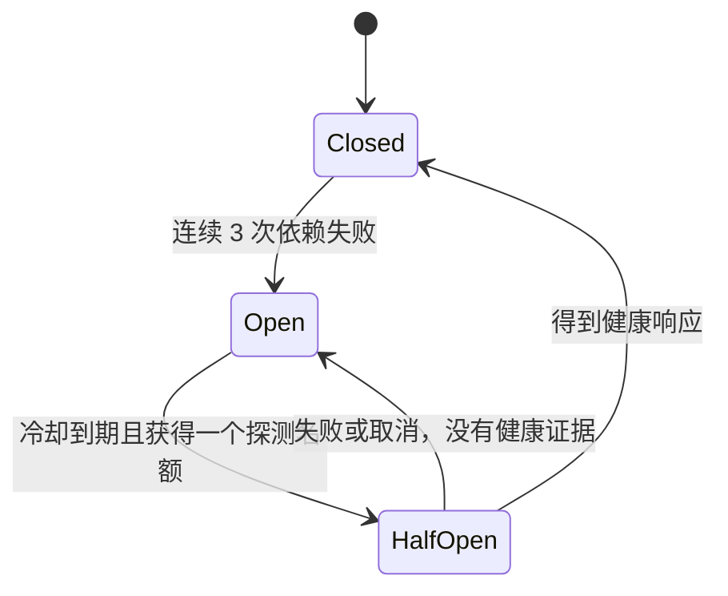

# Search 故障隔离：预算、回退和恢复

岗位搜索的外部依赖失效后，用户仍需要查询资料，新的岗位也仍需要入库和追平索引。这次改进聚焦这一条链路，不增加中间件，不改变 Core 的授权或索引确认规则。

## 问题与基线

已发布版本 `e375960` 为单次远程查询设置 1.5 秒等待上限，然后进行数据库基础搜索。Search 停止时，每个请求仍可能等待；直接缩短总超时又会挤占基础查询的时间。大量请求一齐回退还可能把压力转移给业务数据库。

本轮先在独立容器复现基线，再用相同主机、负载生成脚本和资源限制测量候选版本。结果、样本和限制见下文，不以请求发起率解释系统最大吞吐量。

## 三个独立边界

| 边界 | 默认预算 | 为什么存在 |
| --- | --- | --- |
| 整个 Core 岗位搜索 | 每 API 进程最多 8 个执行中请求；总时间 1.5 秒 | 包含元数据 SQL、远程调用、权限核对和回退，避免无限等待或排队 |
| 远程 Search 查询 | 每客户端最多 8 个；单次 200ms；为更短的上游 deadline 保留 150ms | 缩短故障等待；上游时间不足时直接进入回退，不把它计作依赖失败 |
| MySQL 基础查询 | 每 Store 最多 2 个执行中请求；准入与执行合计最多 1 秒，最多扫描 10,000 个可见岗位 | 控制故障时转入数据库的工作量，保留现有一致快照与扫描边界 |

Core 总读取与远程 Search 名额满时立即拒绝。SQL 回退名额满时，在原有 1 秒预算内最多等待 50ms；外层最多 8 个读取、内层最多 2 个 SQL，因此最多 6 个等待者。等待发生在获取 SQL 连接和开启事务之前。Core 无法执行搜索或完成回退时返回 `503 / SEARCH_BUSY`、`Retry-After: 1`，不返回伪装成“没有岗位”的空列表。前台查询与 SQL 的取消向下传播；短于默认值的上游 deadline 不会被延长。

页面收到搜索失败后仍允许本地列表筛选，并提供“重试搜索”：复用当前条件，由用户明确发起一次新请求。重复渲染不会自动重试，避免在依赖失效时形成浏览器请求循环。

8/2 是初始工程预算，尚未做最大容量标定。它们是每个进程/Store 的本地限制，不是集群总许可；默认 SQL 连接池上限为 16，但共享池仍可能被其他业务占用，不能据此承诺写入时延或数据库全局容量。客户端取消也不证明远端工作已经立即停止。

## 查询熔断状态机



- 初始冷却 2 秒；探测失败后指数退避，最长 8 秒。每个客户端同时只允许一个恢复探测；其他请求使用 Core 回退。
- 冷却到期后，由一次实际查询触发受限后台探测；触发者也立即进入 Core 回退。探测使用同一查询协议与真实查询参数，响应单独存放并丢弃，不复用给当前或其他用户。恢复成功后的下一次查询才尝试全文路径。
- 探测只保留 W3C traceparent，不保留任意请求 context 值、baggage 或 tracestate。它不继承前台提前取消，仍使用准入时算出的绝对远程 deadline（默认最多 200ms，也受原请求 deadline 减去回退预留约束）。独立固定 span `search.query.probe` 可以跨过前台响应结束时间。
- 探测占用原有远程名额，不另建定时轮询或等待队列。客户端 `Close` 停止新准入、取消并等待其拥有的探测；API/Worker 的应用关闭流程在释放数据库/Redis 前调用它。普通全文查询仍同步执行并继承调用方取消。
- 网络/服务不可用和实际依赖超时计为失败。调用方取消、调用方剩余预算不足不计为依赖失败。索引 generation 冲突与参数错误不视为网络失效。
- 每次熔断状态更新携带 epoch。熔断前已发出的慢成功不能关闭新的熔断或抢走探测；旧失败也不能把探测恢复后的状态重新打开。
- 远程 deadline 使用绝对时间 `min(now + timeout, parentDeadline - reserve)`，避免在等待互斥锁后重新计算相对超时、侵占回退预留时间。
- 这是查询侧控制。`Status`、投影 `Apply`、Kafka 发布和 `/v1/applied` 确认保留独立的超时及重试。查询熔断期间，Worker 仍能写入新索引数据，恢复后再开放查询。

“收到健康响应”仅更新通信健康状态。是否能返回全文结果，仍要经过 Core 的 generation、待同步状态、版本、哈希及 ACL 复核；有冲突就回退，不以熔断关闭替代业务正确性检查。

后台探测的复现、权限回归、Trace 与同条件计时结果见 [2026-10-31 恢复探测验收](verification/search-recovery-20261031/README.md)。

## 为什么没有选择这些做法

| 备选做法 | 本项目的取舍 |
| --- | --- |
| 缩短所有 Search 请求的统一超时 | 索引批量写入/刷新和交互查询耗时不同，统一缩短可能妨碍修复 |
| 熔断后停止整个 Search 同步 | 查询失败不应该阻止索引追平；两个路径分别治理 |
| 故障时直接返回旧索引结果或缓存 | 私有范围、岗位删除和新资料可能已变化，仍需 Core 权限与版本核对 |
| 所有请求都无界转入数据库 | 故障压力可能转移至 MySQL；基础查询也需要并发和时间预算 |
| 用 Redis 存一个全局熔断状态 | 当前先约束每个 API 的调用，不增加控制面依赖；多 API 总预算仍需另外评估 |
| 凭一次成功清空所有失败状态 | 需要区分当前恢复探测与熔断前发出的旧请求，使用 epoch 拒绝迟到状态更新 |

## 配置与观测

`SEARCH_QUERY_TIMEOUT_MS` 默认 200，合法范围 20–1500；`SEARCH_FALLBACK_RESERVE_MS` 默认 150，合法范围 20–1000；查询超时与回退预留之和不得超过 1.5 秒的总预算。启用 Search 时配置非法会拒绝启动；Compose 将配置传给 API 和 Worker。它们不改变索引写入超时。变更预算后应重跑相同场景，不能假定所有部署都适合默认值。

追加 Search 观测 overlay 后新增 “CampusTrace · Search 故障隔离” 面板（6 项），显示熔断状态、搜索/回退并发、远程/回退 P95、保护动作及恢复。

主要指标包括 `search_query_circuit_state`（0 closed / 1 open / 2 half_open）、`search_query_retry_seconds`、`search_read_active`、`search_fallback_active`、对应 limit/rejected 计数、`search_query_timeouts_total`、`search_query_circuit_trips_total`、`search_query_recoveries_total`，以及两类耗时直方图。`search_query_probe_fallback_total` 专门记录触发后台探测并立即回退的请求，也是 `search_query_circuit_rejected_total` 的子集，不能相加作为独立请求总数。远程耗时直方图仍包含实际探测耗时，不能将它当作用户请求时延。Core 另按 disabled/pending/unavailable/circuit/remote_busy/budget/snapshot 固定原因计数回退，不使用用户/岗位/搜索词作为标签。

## 复现与故障矩阵

```sh
make resilience-test
make search-test
make kafka-test
make kafka-stack-test
```

这些脚本使用独立的合成库、临时容器和网络，不读取业务 `.env` 或调用真实模型。

| 场景 | 检查什么 |
| --- | --- |
| 100 个客户端调用争抢 2 个远程名额 | 恰好 2 个在执行，其他立即拒绝，不建立等待队列 |
| 熔断后旧请求成功/失败 | 不关闭正在进行的探测，也不重新打开已经恢复的状态 |
| 50 个调用同时遇到恢复窗口 | 仅一个探测，其余直接回退 |
| 恢复请求返回后取消；多个账号先后查询 | 探测继续受原截止时间约束；前台不等待，探测结果不跨请求复用 |
| 探测期间权限变化，恢复后查询旧命中 | 探测仅证明通信健康；Core 仍以当前 ACL/版本/哈希决定可见结果 |
| 探测超时、多个关闭与准入并发 | 保留 2/4/8 秒退避，停止后不发新探测，活动名额归还 |
| 取消、短 deadline、绝对预留时间 | 不因调用方预算污染依赖健康；回退预留不漂移 |
| 真实 HTTP 超时、400/409 | 超时可触发熔断；语义冲突不作为网络失效 |
| 真实 Core + MySQL + Search + OpenSearch，查询链路注入停顿 | 回退仍核对私有权限；查询熔断时新岗位能索引；解除故障后自动恢复全文模式 |
| 2,001 个合成岗位、100 并发 HTTP 查询及同时写入 | 成功查询或明确 503，回退同时最多 2 个，真实录入事务完成，名额归还 |
| MySQL jobs 表写锁阻塞基础查询 | 时间预算耗尽后返回可重试错误；解锁后恢复，不把取消当空结果 |
| 原 Search 与 Kafka 回归 | generation、墓碑、旧确认保护、消费者独立恢复、重放去重等原契约保留 |

## 历史同机前后对照

本机 aarch64 Docker，API / Search / MySQL / OpenSearch 各 1 CPU；1,000 个初始岗位与 1 个更新岗位、两个账号、固定 1,032 字节合成 JD。每场景 15 秒、固定 10 次/秒查询，mixed 另有 1 次/秒更新；基准为 `e375960`，候选为当前改动的冻结副本。准备、预热和初始结构化分析不计入查询测量。

| 场景 | 基准 P95 ms | 候选 P95 ms | 基准 P99 ms | 候选 P99 ms |
| --- | ---: | ---: | ---: | ---: |
| fulltext | 14.52 | 14.23 | 15.71 | 14.87 |
| fallback | 1250.24 | 6.80 | 1264.92 | 205.36 |
| rebuild | 13.25 | 11.48 | 15.60 | 13.56 |
| mixed | 11.81 | 11.06 | 15.61 | 12.21 |

四个场景各 151 次查询，共 604 次；mixed 完成 15 次岗位更新。均无 HTTP 错误、丢弃迭代或响应/账号检查错误，最后更新可通过索引找到。参考与候选环境/负载校验一致，稳定全文及回退场景通过原有宽松工程回归门槛（1.5 倍 + 25ms）；这不等于统计显著性检验。

当时的回退 P95 下降主要来自故障时跳过远程等待。P99 约 205ms，仍包含首次失败与同步周期探测；后续改为后台恢复探测，新的验证另存，历史数据不改写。首次故障识别仍可能等待远程超时，SQL 回退也有自身成本，不承诺所有故障请求都在个位毫秒内完成。正常全文查询没有据此声称优化收益。

精简结果见 [performance-comparison.json](verification/depth-20261031/performance-comparison.json)；同目录保留两份原始 report。完整日志与 Prometheus 快照在 ignored `bin/verification/depth-20261031/`。


这轮历史实验是单机、短时间、合成岗位、固定 10 次/秒请求。它证明指定场景下的等待和恢复行为，不证明生产容量或大规模高可用。恢复期间可继续基础查询，但重新启用全文检索可能等待最长冷却窗口及一次受限探测。混合/重建场景的基础与全文模式比例不同，不把混合 P95 当作全文性能提升。
