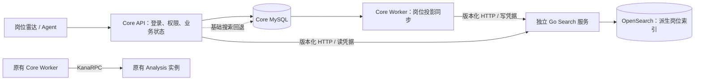

# 独立 Search 服务

本文默认描述直接 HTTP 同步模式。可选 Kafka 模式保留这里的版本、generation、Core 权限复核和回退规则，将更新改由 Search 独立消费；Core 通过搜索可见性接口确认索引，详情见[岗位事件](job-events.md)。

Search 解决岗位名称无法覆盖 JD 技术要求的问题。例如，标题只有「服务器工程师」，JD 中包含 C++、Redis 或分布式开发要求，用户仍可用这些词找到岗位。岗位雷达与 Agent 的 `search_jobs` 共用 Core 搜索入口；求职资料、资格判断、个人优先级和投递状态继续由 Core 处理。

## 运行边界



- Search 有自己的入口 `cmd/search`、`Dockerfile.search`、健康检查、限流、配置和独立镜像。共享 Go module 中的协议类型不依赖 Core。运行依赖只有 OpenSearch；没有 MySQL/Redis/etcd 驱动或 Core 持久化依赖。共享观测代码使用 `sql.DBStats` 类型输出指标，不会建立数据库连接。
- Compose 中 Search 只连接 `search-rpc` 和 `search-index` 两个内部网络；没有 Core 数据库网络、数据库凭据、JWT 密钥或模型密钥。OpenSearch 不发布主机端口。
- 只同步岗位 ID、数据集 ID、版本、权限范围/所属用户、公司、标题、城市、类型、岗位状态和最新 JD。不会同步简历、教育、项目、匹配报告或投递材料。位置字段在派生投影中限制为每项 256 字节，原始岗位资料不变。
- 当前使用 OpenSearch 3.9.0、内置 CJK 分词和 BM25；C++、C#、Go/Golang 单独建立技术词字段，避免标点消失或 `Google` 误命中 Go。支持全部/任一关键词、排除词、公司/城市/类型过滤；没有引入向量、模型调用或语义匹配。

## 查询侧故障隔离

交互查询现有独立时间预算、进程内熔断、单探测恢复和 Core 搜索/回退并发上限；过载返回明确的可重试错误。状态查询、索引同步和 Kafka 消费继续独立运行，ACL/版本确认保持。配置、故障矩阵和同机对照见[Search 故障隔离](search-resilience.md)。

## 更新、重试与重建

迁移 `017_search.sql` 新增四张表，不删除已有业务数据：

| 表 | 职责 |
| --- | --- |
| `search_revision_state` | 稳定数据集标识、单调版本和回填/巡检游标 |
| `search_documents` | 每个岗位最新的完整派生快照；删除保留墓碑 |
| `search_outbox` | 与岗位写入同事务提交的待同步记录；同岗位合并为最新版本 |
| `search_sync_state` | 当前索引代次、回填游标和就绪标记 |

录入与状态评估在业务事务内更新派生快照及 outbox。一个很短的版本计数器锁确定提交顺序，远程请求始终在事务外。Worker 使用连接持有的 MySQL 命名锁协调多个同步器；确认前再次核对连接所有权。发布成功后仅删除相同岗位且相同版本的记录，新更新不会被旧确认删除。

Search 使用外部严格版本写入：旧版本无害忽略；相同版本且内容哈希相同可重放；相同版本但内容不同返回冲突。批次部分失败或响应丢失时 Core 保留记录，重试整个批次。批次最多 64 个岗位，并按编码后大小拆分为不超过 4 MiB 的 HTTP 请求，避免转义文本阻塞同步。

数据库回退恢复到旧备份后，必须执行 `make search-rebuild`；否则已有索引中的外部版本可能高于恢复后的 Core，导致持续回退。不要让克隆数据库与原数据库同时写入同一个索引 alias。

索引代次由「实际索引名 + OpenSearch UUID」组成。管理员重建通过原子切换 alias 创建空索引；丢失索引后重新创建也会得到不同 UUID。Core 发现代次变化后重放全部快照，再清空积压。墓碑同样参与重放，延迟的旧更新不能恢复已删除岗位。旧索引保留供排障，需管理员按实际索引名清理；当前没有自动清理策略。

升级前已有的岗位会按主键分页回填。日常每 10 秒巡检至多 100 个岗位及 100 个删除项，修复绕过应用的历史/运维写入；周期随数据量增长。直接 SQL 更改仍应优先走正式业务入口或触发重建，不属于即时同步契约。

## 读取与失败行为

1. Core 从登录态填入 user 和数据集，客户端不能指定其他用户。Search 先过滤 GLOBAL / 本人 PRIVATE。
2. 初次回填未完成、索引回放未完成或存在待同步记录时，Core 直接使用基础查询。
3. 正常查询给 Search 1.5 秒预算。Core 在一致性快照内复核水位、实际岗位权限、版本和当前内容哈希，分批获取业务资料。
4. 返回异常、索引代次变化、权限/内容不一致、岗位已删除或依赖不可用时，整次请求回退到 Core。
5. API 每次最多返回 1,000 个岗位；额外一个命中也经过 Core 权限复核，才返回 `more` 提示。基础回退按字面关键词扫描至多 10,000 个可见岗位，达到界限同样提示缩小范围。基础搜索的字面语义与 CJK/BM25 不完全相同。

这里采用保守的全局就绪门槛：高频持续更新可能造成较多回退。没有改造整个岗位清单、个人排序或 inventory 快照的扫描方式，也未验证大数据量吞吐。索引中同 UUID 的人工局部删改/任意破坏不能靠代次识别，应执行重建。

雷达保留个人筛选和排序，关键词结果使用服务端返回的岗位集合，避免 JD 命中再次被本地标题过滤掉。异步返回按账号、清单版本和查询状态隔离；旧请求、退出页面、清空搜索均不会覆盖新结果。搜索结果不写入浏览器存储。

## 本地启动与操作

已有数据先按[恢复说明](recovery.md)备份。默认 `./campustrace start` 不启动 OpenSearch；可选完整栈使用：

```sh
make search-stack
make search-status
make search-rebuild   # 创建新索引并由 Core 自动回放
make search-stop      # 停止这套栈，保留全部数据卷
```

`./campustrace status/stop --all` 只认识原有服务；启用 Search 后用上述 Compose 目标管理完整栈。回退至普通启动前先 `make search-stop`，再 `./campustrace start`。普通镜像不包含 `/app/search`。

单独发布/替换 Search，不重启 Core / Analysis：

```sh
docker compose -f docker-compose.yml -f compose.app.yml -f compose.search.yml build search
docker compose -f docker-compose.yml -f compose.app.yml -f compose.search.yml up -d --no-deps --force-recreate search
```

同时接入原有监控：

```sh
docker compose -f docker-compose.yml -f compose.app.yml -f compose.search.yml \
  -f compose.observability.yml -f compose.search-observability.yml up -d --build --wait
```

Grafana 新增独立 Search 面板（9 项），原概览保留。新增请求量、P95、错误、待同步数、投影就绪、基础/完整搜索次数和同步指标。W3C traceparent 同时覆盖 Core → Search → OpenSearch 以及持久化 outbox 发布；合并批次跟随首条记录的 trace，没有为批内每个岗位建立独立链接。Search 内部操作不输出 JD、关键词、用户 ID 或凭据到 trace 属性。

Compose 使用本地演示凭据且关闭 OpenSearch 安全插件，只适用于当前隔离的单机演示。对外部署需另行配置 TLS、独立强凭据、索引认证、容量及备份策略；不应把这套默认配置直接暴露公网。OpenSearch 配置 512 MiB JVM 堆、1.5 GiB 容器内存上限；不是轻量默认依赖。未修改宿主机内核设置。

主机调试的环境变量：

| 进程 | 配置 |
| --- | --- |
| API | `SEARCH_URL`、`SEARCH_QUERY_TOKEN`；没有写凭据 |
| Worker | 以上两项及 `SEARCH_WRITE_TOKEN`，读写凭据不同且至少 32 字节 |
| Search | `SEARCH_ADDR`、读写凭据、`OPENSEARCH_URL`、`SEARCH_INDEX_ALIAS` |

## 复现验收

```sh
make search-test   # 独占临时 MySQL/Redis/etcd/OpenSearch，合成数据与真实 HTTP
CAMPUS_SMOKE_SEARCH=1 sh scripts/observability-local.sh  # 独立镜像 + 全链路监控
SEARCH_TESTS='^Test' sh scripts/search-local.sh           # 包含整套后端集成回归
node --test web/*.test.cjs
go test -race ./...
go vet ./...
```

验收覆盖多页历史回填、私有隔离、JD 搜索、中文和技术词、重复/乱序/冲突、成功后丢响应、更新期间确认、删除墓碑、索引丢失/重建、Search 停机时 Core 写入及 Analysis 继续处理、独立替换 Search 后补齐积压、真实 Tempo trace 和 Prometheus/Grafana。

本地证据保存在忽略提交的 `bin/verification/search-20261030/`。这些是单机、合成输入与局部故障验收，不是生产 HA、吞吐、搜索质量或用户效果证明；没有调用付费模型、导入真实求职资料或修改现有运行数据。
