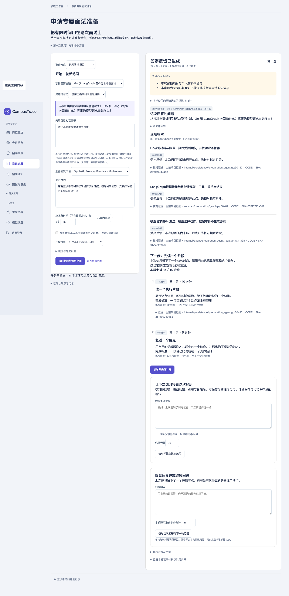

# 答辩跨练习记忆与对照验收（2026-11-02）

入口：投递进展 → 申请档案 → 练习讲清项目。完成答辩后，“让下次练习接着这次经历”预览原回答、反馈、代码来源和用户备注，经确认保存。新练习可带入已确认的同主题经历，也可关闭；“已确认的练习记忆”支持纠正、停止采用和遗忘。[设计与复现命令](../../project-defense.md#跨练习记忆)。

Go负责授权、记录提取、记忆选择、版本、事务与确认回执；LangGraph沿用既有模型／工具循环，模型结合本次回答和历史经历选择后续行动。历史代码不自动算作本轮已读来源。复用现有MySQL JSON记忆表与确认接口，没有新依赖、存储服务或数据库迁移。模拟经历不标记掌握、不进入普通问答的偏好上下文，也不作为真实面试失分。

## 本轮实测

| 范围 | 结果与证据 |
| --- | --- |
| 基线 | [新增前的测试失败](baseline.txt)：已确认的跨练习经历不在模型上下文中 |
| Go | 编译、vet、[全包测试](go-tests.txt)与[internal race](go-race.txt)通过 |
| 前端 | [467项通过](frontend-summary.txt)，含来源展示、转义、纠正与遗忘入口 |
| Python | LangGraph [4项通过](python-graph.txt)，评测／审阅脚本[8项通过](python-scripts.txt) |
| 记忆开关 | [24条合成受控任务](controlled-summary.json)满足程序预期：6调试、18保留回归；22完成、2模拟未知请求暂停，共46个脚本化模型回合 |
| 成对记录 | [12组带入／关闭结果](memory-pairs.json)：保持当前回答、材料、模型和预算一致；保留没有采用记忆、没有回答差异的结果，语义分数留空 |
| 产品 | [48项实际Go＋Python＋SQL检查](product-acceptance.json)，其中[记忆专项14项](memory-acceptance.json)：确认与回执、同练习去重、跨申请来源、账号隔离、代码变化、纠正、旧预览拒绝、遗忘及防复活 |
| 浏览器 | [记忆交互9项通过](browser.json)：预览无写入、确认保存、刷新后带入、实际范围、纠正、有异议排除、遗忘和页面错误检查；原答辩浏览器用例也通过 |
| 原有链路 | [原答辩20例](defense-regression.json)及[原准备24任务×3组＝72条受控结果](preparation-regression.json)符合程序预期；保留取消、已知回执复用、Python进程强杀后的持久检查点恢复与未知请求授权检查 |

浏览器与数据库检查使用脚本创建的隔离账号、临时MySQL／Redis／Kafka及本地脚本化模型服务。保存检查最终数据库记录和回执，遗忘检查正文、回执、已带入记忆的旧执行上下文都不再提供该经历；旧确认重放不能恢复内容。代码版本排除使用明确的SQL注入夹具，不描述为真实滚动升级实验。

## 对照与审阅范围

任务覆盖旧遗漏、旧支持反馈与新回答未展开、用户纠正、有异议、其他主题、旧代码、过期、数量与字节上限、指令注入、无记忆、未知请求和5分钟安排。当前候选均为合成控制，固定日期用于过期分支；不代表真实用户材料或产品允许的超长保留期限。真实产品只允许1～365天，默认90天。

成对报告中的追问差异来自预设模型分支，不能据此得出语义质量、抗提示注入能力或学习效果提升。模型请求次数与用量是受控计数；测试耗时不作为真实模型延迟或成本指标。各结果的实际提示哈希、框架、证据包和任务集版本由评测报告单独记录，[摘要与源码快照](summary.json)。

既有人工审阅导出已能展示历史候选、实际采用记忆、原回答、本轮反馈及引用。由实际受控报告截取3组、6份审阅页，保留原报告哈希及结果索引，存放在仓库外；全部语义分数为未审阅，未填写独立人工或目标用户评价。评分结构校验通过不代表评分结论正确。

## 初次失败与修正

- 基线测试复现没有跨练习上下文，随后增加确认记录选择与模型上下文绑定。
- 第一次API夹具缺少岗位必填类型，在模型请求前被拒绝；补齐合成岗位字段，没有放宽接口校验。
- 首次成对回归中，多记录用例预期3条，但实际因24KiB上限只带入2条；保留该失败，修正合成预期，同时保留独立的3条数量上限与超大单条排除测试。
- 扩充用例后，后续原准备场景触发了原有全局每分钟30次调用保护。受控回归调整为等待自己创建的Redis限流窗口后再运行记忆批次，不提高、清空或绕过限额。日志中的早期UNKNOWN暂停不计成功。
- 首次从仓库根目录运行Python图测试时缺少模块导入路径；改在服务目录执行已有测试命令，4项通过。未改变模块加载来迁就错误命令。

这些调试日志和中间报告保留在仓库外 `output/evaluations/campustrace-defense-memory-20261102/`，历史已提交报告保持原样。

## 剩余验证

本轮真实模型调用为0，原120次授权预算已用满，没有扩大额度。最值得继续验证的是少量真实回答：记忆是否帮助追问实际遗漏、是否把旧反馈误当成当前能力、纠正是否得到遵守、额外上下文是否造成退化。使用相同模型与材料做带入／关闭对照，结合原回答和代码人工审阅；保留无收益与失败，不能只看记忆命中数量。

实现仍限定于已有两个答辩主题；代码证据包变化后旧记录不自动迁移为新版本。遗忘沿用已有数据清理范围，尚未确认的Redis提案按原10分钟期限过期，已外发内容与旧备份不能收回。本目录记录提交前的本地实现与验收结果；发布提交和CI状态以仓库记录为准。
