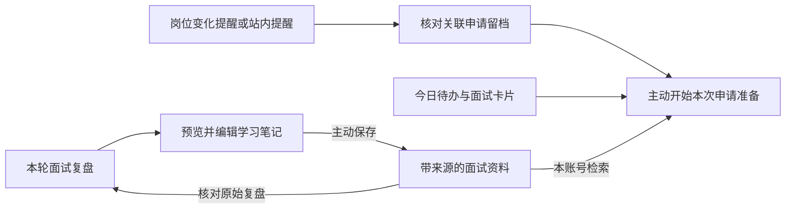

# 岗位、申请、复盘与学习资料联动验收

日期：2026-10-31；本轮基线为 `f17b1ae`。复用 Core MySQL、现有 RAG 和申请准备任务，来源元数据保存为文档 JSON 的可选字段，旧记录兼容。

## 使用链路

- 招聘变化待办、站内提醒和助手读取到的变化结果，可打开本人在该岗位的申请留档。关联阶段读取当前申请表；正文中的旧事件不承担所有权或当前状态的判断。一个有界批量查询读取申请 ID/阶段，不读取简历或备注。`UNIQUE(user_id,job_id)` 保证每个岗位至多一项本人申请。
- 面试卡片、今日待办可预填该申请的准备任务，仍需主动开始。保存复盘后定位回这一轮面试，避免在列表中重找。
- 复盘到笔记先读取完整可编辑草稿，主动保存后才写入知识库。来源含申请/面试/复盘 ID 和服务端快照键；普通导入不能伪造来源。写入在用户锁内重新校验原始复盘，旧版本拒绝保存。同来源/标题/正文的重复与并发提交复用同一文档。来源不同的材料保持各自记录。
- 文档、检索片段和知识库版本一起提交；新资料使旧准备检查点失效，下一次主动准备能检索复盘笔记。完整材料可返回原始复盘（直接展开本轮）、申请留档或预填新准备。笔记正文允许编辑，来源仅描述保存时所依据的复盘，不作为个人能力或原复盘始终未变的证明。

## 验证

| 检查 | 结果 |
| --- | --- |
| `GOWORK=off go build -mod=readonly ./...` / `go vet ./...` / `go test -race ./...` | PASS |
| 前端 | 451/451 PASS |
| Python 验收入口防护 | 5/5 PASS |
| 全量隔离 MySQL/Redis/etcd race | [PASS](sql-result.json)；测试数量与环境跳过见[明细](sql-tests.json) |
| 真实 Chromium + 本机无模型 HTTP 服务 | [PASS](browser-result.json)，页面异常 0 |
| 进程恢复与已有说明回归 | [PASS](result.json)；取消、断线、SIGKILL、owner/CSRF/nonce 仍通过 |
| 上游测试服务 | [计数](fixture-final.json)；新增业务闭环前后聊天调用数相同，结束 active=0 |
| 独立 Search / 已发布 RPC 依赖边界 | PASS，仍为 KanaRPC-Go v0.1.0、GOWORK=off |

浏览器实际完成：提醒历史 → 本人申请留档（没有自动标记已读）；变化提醒 → 申请；面试卡片 → 预填但不启动；复盘 → 预览、编辑并保存笔记（预览不写库）；笔记 → 展开原始复盘；新准备 → 命中刚保存的笔记；今日待办 → 预填同一申请。所有账号和内容均为合成数据。

SQL 回归验证跨账号复盘/笔记隔离、拒绝伪造 origin、并发去重、资料导入使旧任务 STALE、删除后重建而非恢复旧 ID、源复盘变化后 409，以及申请阶段变更后提醒返回当前阶段且不回写事件正文。

首轮新增 SQL 测试先纠正了两处夹具假设：全局导入应使用已登记来源，启用变化提醒后保存个人资料也会产生 PROFILE_CHANGED，因此按岗位选取目标提醒。保留首轮失败，最终全量通过。

完整日志、原始 JSONL、截图、失败记录和源码哈希保存在本机 `bin/verification/linkage-20261031/`。复现浏览器使用 `scripts/verify-agent-explanation.py --playwright-module /absolute/path/node_modules/playwright --output /tmp/ct-linkage`；SQL 使用 `scripts/verify-integration-isolation.py --race --count 1`。

本轮检索为本地 BM25，说明上游为本机无模型服务；没有新增真实模型质量、真实 Embedding/重排序、用户节时或生产容量证据。站内提醒的浏览器记录由隔离 SQL 合成注入，只验证读取与导航；Kafka 事件投递不作为本轮新增验证。未提交或推送本轮改动。
