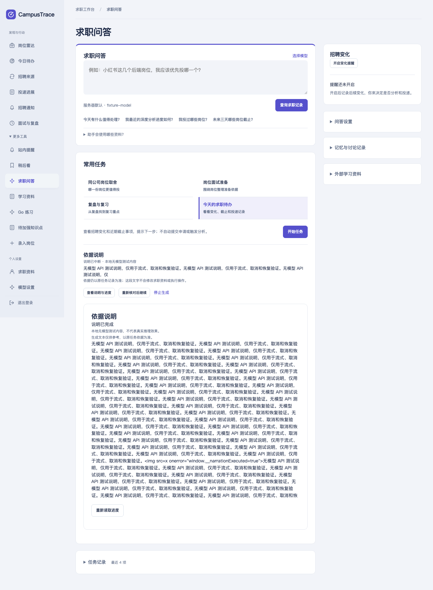

# 日常模型 API / 可选 RPC 后端验收

2026-10-31。代码位于 CampusTrace 工作区；本轮没有修改 KanaRPC-Go、真实 `.env` 或运行中的部署，没有提交、发布 SDK 或调用真实云模型。项目原有 Analysis RPC/etcd、Kafka、搜索与观测工作保留。

## 完成内容

1. 按[实施步骤](../../model-backends.md)核对现有调用：普通 Agent/简历/匹配已有 ChatClient，流式依据说明此前仅能选择未发布 SDK 的 RPC 入口。现在依据说明默认直接使用服务器 `LLM_*`，`NARRATION_BACKEND=rpc` 才启用实验路径，另有 `disabled`。
2. 复用 ChatClient 原有服务商参数和 semaphore；提取原请求参数构造方法供普通/流式共同使用，普通请求行为不变。新流式适配不依赖未发布 RPC SDK，不发送工具、原始 owner ID、cache_salt 或网关控制字段。全局说明限流由 runner 执行一次。
3. 保留原 NarrationRunner、SQL checkpoint、只读 SSE、同源/认证/owner 边界、nonce/尝试回执、取消围栏与 UNKNOWN 恢复。UI 与状态机不用重写。服务商模型别名可返回规范化版本名；客户端仍只请求服务器配置的模型。
4. 增加有界 SSE 解析：LF/CRLF/CR 与跨网络读取的换行、注释心跳、多行 data、usage、文本输出、终止标志。工具/函数调用、拒绝、超限、坏帧、缺少 finish 或 DONE、截断/过滤、断流不能标成完成。HTTP 错误、重定向或协议不兼容均不自动重试、不切换后端，错误不包含密钥或上游正文。

## 复现与验证

| 阶段 | 复现/断言 | 结果与证据 |
| --- | --- | --- |
| 原功能缺口 | 默认构建只配置 LLM_URL/LLM_MODEL，调用 FromEnvironment 得到 nil；TestDailyAPIEnabledWithoutUnpublishedSDK 要求正常 API 配置可支持持久说明 | 修改前明确失败：[原日志](logs/selection-before.log.gz)。原因是工厂只读取 INFERENCE_RPC_ADDRESS/INFERENCE_MODEL；改后 API/配置矩阵通过 |
| 协议与并发 | 真实 loopback HTTP 流首段先到、取消关闭上游、超时/等待共享 slot 释放；401/429/500/307 只请求一次且不重定向；模型别名、服务商参数、异常帧与输入权限边界 | 新增单元/子测试通过，race 重复运行：[最终日志](logs/unit-final.log.gz)。额外补充的服务商参数与非 SSE 用例共 8 项在该日志单独 race count=2 验证 |
| 协议 fuzz | FuzzChatStream：有界文本、事件/整流上限、换行和任意输入，不允许崩溃或无界输出 | 实际 fuzz 344611 次执行，通过；仅是解析健壮性测试：[日志](logs/fuzz.log.gz)，不是推理性能数据 |
| SQL 中断恢复 | 首次 HTTP 断流保留草稿并 PAUSED/UNKNOWN；重启、读取、重复创建回执不调用模型；未确认未知结果拒绝重试；同次重试回执仅调用一次 | 含 TestNarrationAPIRecoveryAndBackendChangeBoundary 的 narration 集成 race count=2，**26 pass / 0 fail**；[清理审计](narration-race-isolation.json)、[完整日志](logs/narration_race.jsonl.gz) |
| 切换模型/后端 | 新模型使 review hash 改变；旧任务的批准不能转发给新模型，旧草稿仍可读；重新预览的新说明任务可显式执行 | 上述 SQL 集成测试验证；同模型/地址重启恢复不受影响 |
| 日常 API 进程与浏览器 | 实际 API/MySQL/Redis/HTTP fixture 与真实 Chromium；预览零调用、确认后流片段、刷新重订阅、权限与 CSRF、并发 nonce、取消、SIGKILL/SIGTERM 与未知结果重试、HTML 作为文字 | **PASS**：[进程结果](api/result.json)、[浏览器结果](api/browser-result.json)、[计数](api/fixture-final.json)。7 次测试调用，3 完成、4 取消，active=0，invalid_requests=0；初轮和最终轮均通过 |
| 可选 RPC 回归 | 使用既有 v0.2.0-rc.4 本地候选，API→gateway→worker→fixture | **PASS**：[结果](rpc/result.json)。4 次调用、2 完成、2 取消；[状态](rpc/fixture-final.json)。本轮 RPC 进程回归未重复运行浏览器，浏览器完整流程由 API 后端实际执行 |

## 全量回归

统计包含 Go 子测试，跳过列表完整保留在 [results.json](results.json)。

| 检查 | 实际结果 |
| --- | --- |
| 默认公开依赖构建，GOWORK=off go test -count=1 ./... | **1987 pass / 241 skip / 0 fail**：[日志](logs/default.jsonl.gz)。未启用 SQL 等依赖的用例在此轮跳过 |
| 独占 SQL/Redis/etcd 全量 go test -race -count=1 -shuffle=60431 ./... | **2193 pass / 41 skip / 0 fail**：[日志](logs/full_race.jsonl.gz)。后补的 8 项纯协议子测试另由最终单元 race 覆盖，不混入本轮计数 |
| 测试隔离审计 | 测试 schema/account 均 **0**，模板哨兵仍是唯一表且内容不变：[结果](full-race-isolation.json)。脚本最终只清理其拥有的容器 |
| 可选 kanarpc_stream + 候选 SDK 的 analysis/bridge/agent/transport race | **PASS**：[日志](logs/rpc-tag-race-after.log.gz)、[独立缓存解析](sdk-regression-resolution.json) |
| go vet ./... | **PASS**：[日志](logs/vet.log.gz) |
| Node 前端 | **444 pass / 0 fail**：[日志](logs/node.log.gz) |
| SDK 消费 guard / 真实服务入口 guard | **5 + 5 pass**：[SDK](logs/sdk-python.log.gz)、[入口](logs/live-guards.log.gz)；入口 guard 自身也是无模型测试 |
| 默认发布依赖 / Search 依赖边界 | **PASS**，根依赖继续 v0.1.0：[日志](logs/release-boundary.log.gz)，未修改 go.mod/go.sum |

41 项跳过包括真实招聘来源、Kafka、OpenSearch、沙箱及未打开的多进程对抗开关；不能视为这些环境已验收。本轮默认全量包含已有并行工作区代码，但 Kafka 等专项外部依赖验收不在本轮范围。

保留了一次手工 RPC race 命令的环境错误：[失败日志](logs/rpc-tag-race.log.gz)。该命令只指定候选 modfile，漏带独立 GOMODCACHE/GOPROXY，因而查公开 proxy 的未发布 rc.4 得到 unknown revision。之后通过正式 prepare 入口加载完整隔离环境重跑成功；没有以 sibling replace 或发布版本伪装修复。

代码文件哈希见 [source-manifest.json](source-manifest.json)，本轮范围见 [change-scope.json](change-scope.json)。证据文件不包含真实密钥、业务数据库或二进制依赖缓存。

## 尚未验证与保留限制

- **真实云 API、模型回答质量、真实 vLLM/GPU、缓存命中和推理性能：NOT_VALIDATED。** 无模型 fixture 的响应、usage、取消计数均不是真实模型结果。
- 客户端取消证明 HTTP 请求结束和迟到写入被拒绝，不证明服务商立即停止计算或计费；512 token 与进程内 semaphore 也不是模型账户总费用上限或全局集群许可。
- 仅适配文本 Chat Completions SSE。未提供 Responses、Anthropic Messages 等其他原生协议；不支持本轮请求参数的兼容服务必须单独验证，不能靠自动重试探测。
- 流式能力用于经审阅依据说明；普通多轮 Agent、匹配等流程没有在本轮全部流式化。服务器固定模型不会被网页临时配置覆盖。
- 草稿是 SQL 最新快照，含脱敏与 256 rune 尾部暂存；短响应可能直到结束才出现。任务恢复读取旧草稿并显式发起新尝试，不是逐 token 日志、exactly-once 或接续推理。
- 换模型/地址/后端需从父任务重新预览创建新说明，旧批准不跨后端复用。旧完成结果及中断草稿保留可读。
- 可选 RPC 仍使用未发布本地候选；本轮没有新增 SDK 发布或真实 GPU 服务部署。

