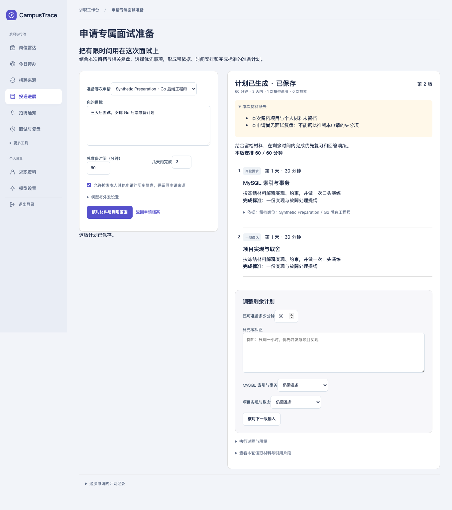

# 申请专属面试准备 Agent 验收

2026-11-01。在既有未提交 RPC 工作之上增量实现 Agent 场景；没有修改简历，没有新增表、依赖或服务。[原工作区保护核对](preexisting-work-preservation.json)记录起始 46 个修改/未跟踪文件：44 个内容完全不变，`.gitignore` 与 `docs/model-backends.md` 只追加 Agent 内容，原文前缀哈希保持一致。

## 交付与基线

新增入口：申请档案 → **生成面试准备计划**，以及求职问答中的申请准备卡片。模型可选择本账号笔记检索、授权的历史复盘检索、有限改写、澄清和计划提交；程序校验时间、范围、引用、掌握/完成项与保存条件。用户反馈创建新版；业务保存需独立确认。

[升级前复现](before-upgrade.txt)使用受控响应运行原 Runtime：冻结档案读取成功，但模型给出的 180 分钟计划被原程序终答替换；旧申请准备只有一个固定读取/检索步骤，没有时间和掌握反馈输入。这个结果证明具体能力缺口，不代表原 Runtime 没有工具循环。

完整设计、演示、恢复机制与评测入口见[功能说明](../../application-preparation-agent.md)。

## 检查结果

| 检查 | 结果 |
| --- | --- |
| 全包真实依赖竞态与进程回归 | 631 个顶层测试通过，35 个条件跳过，无失败 |
| 其中真实依赖集成 | 208 个顶层测试通过、17 个条件跳过，已包含在总数中 |
| Agent 包 | 38 个顶层测试通过，含场景矩阵的子测试 |
| 前端 | 458 项通过 |
| 构建、vet、依赖边界、模块校验 | 通过；模块整理差异为空，既有 Search/RPC 边界保持有效 |
| API/数据库/浏览器 | 实际 API、MySQL、Redis、Kafka 和 Chromium 通过；脚本化 HTTP 模型响应共 6 次，外部模型调用 0 次 |
| 进程强杀 | 保留 DISPATCHED、已完成读取和预算预留；无确认重试返回 409，明确确认后仅新增一次请求且不重放已完成读取 |
| 清理 | 隔离测试库/账号剩余均为 0，模板保护标记保留；进程验收只清理本轮容器 |

[机器汇总](acceptance.json)、[准备专项结果](preparation-test-results.json)、[集成隔离](native-integration.json)、[条件跳过列表](conditional-skips.json)、[源码指纹](source-sha256.json)、[依赖边界](dependency-boundary.txt)。条件跳过未计作通过。

## 三类证据

### 确定性程序行为

- 参数、模型/工具/输出预算、时间窗口、总分钟数、引用编号/原文/类型绑定、重复事项及掌握项排除。
- 本人申请与保存权限、今日资料不替换冻结材料、历史快照缺失保持 unknown。
- 请求编号去重、模型前预算预留、已完成读取恢复、待执行读取、未知模型调用保护、取消后的迟到写入隔离。
- 独立保存确认、申请与计划版本、来源身份、相同回执重放；知识库变化后旧保存提案被拒绝。
- 终态动作与查询混在同一批时拒绝整批，不留“已结束但还有隐藏待执行步骤”的状态；参数体量限制在持久化之前检查。

这些断言检查实际程序与 SQL 状态，不以生成文字替代业务提交。

### 受控响应与界面

[API/进程验收](process-acceptance.json)和[浏览器结果](browser.json)验证从申请档案点击入口、输入复查、任务进度、掌握项排除、60 分钟新版计划、显式保存及刷新读取。脚本化响应只用于走通分支，没有真实推理模型。



[受控计划记录](controlled-plan.json)、[强杀恢复记录](controlled-recovery.json)保存实际任务状态、工具轨迹和预算。恢复测试只在本轮数据库中把该任务租约设为过期，不是等待 60 秒的恢复时间测量。

### 真实模型效果

本目录记录首次受控验收。后续真实 DeepSeek Flash 调用及修复复测另存于[真实模型评测](../preparation-agent-live-20261101/README.md)，下述“未运行”是本目录生成时的状态，原始受控结果保持不变。

未运行。没有取得本轮明确授权的真实模型配置、真实脱敏材料及人工效果标签。未读取浏览器/个人 `.env` 密钥，也未外发个人求职数据。任务完成质量、语义依据支持、真实耗时、真实 Token 与费用收益仍待单独验证；评测 CLI 已具备明确配置、数据 SHA-256 授权和调用上限。

## 小规模对照与无收益结果

24 个任务全部为合成控制，6 个调试案例、18 个保留验证案例；[任务原文与预期](../../../internal/agent/testdata/preparation-tasks.json)可审阅。它们允许不同有效工具路径，检查终态与约束，不要求固定动作顺序。两项程序前置边界（来源变化、其他账号申请）不调用模型；真实权限与版本变化另外通过 SQL/API 验收。

| 分组 | 一次提示 | 固定检索后一次综合 | 动态工具调用 |
| --- | --- | --- | --- |
| 调试 6 例程序期望 | 6/6 | 6/6 | 6/6 |
| 调试模型请求 | 6 | 6 | 9 |
| 保留验证 18 例程序期望 | 18/18 | 18/18 | 18/18 |
| 保留验证模型请求 | 16 | 16 | 29 |
| 保留验证检索调用 | 0 | 16 | 13 |
| 保留验证依赖失败 | 0 | 1 | 1 |

[调试明细](development.json)、[保留验证明细](validation.json)、[汇总与解释](evaluation-summary.json)。单次提示获得同一允许范围内的小型完整语料，作为强基线；固定组复用旧字面查询构造与 BM25，再做结构化综合适配。三组共用目标、时间与准入预算。CLI 不执行业务写入，实际保存状态由上面的独立验收核对。

这个对照没有体现动态方案的质量收益：同样的程序期望全部通过，而动态方案调用更多。耗时来自本地脚本化响应，不作为真实模型延迟或用户准备效率；控制响应不生成真实费用指标。真实模型下是否值得增加查询，需要授权后的保留集与人工审阅回答，不能把 18/18 宣传成真实 Agent 任务成功率。

## 失败与恢复场景

- 检索无结果：可有限改写或利用现有依据结束，不能补造材料；检索依赖失败单独记录，不等同于参数无效。
- 缺少时间/历史快照：询问缺失信息，旧快照缺失时不调用当前资料工具补造。
- 模型响应中断/SIGKILL：不自动重放，保留已完成工具与未知预算占用，显式新尝试后继续。
- 来源变更：旧保存被 SQL 事务校验拒绝；今日个人资料更新不会替换本次冻结材料。
- 其他账号申请：读取/预览返回 404，不能通过模型参数扩大范围。

本轮发现并补齐了派发前预算持久预留，以及混合终态动作的批次拒绝；API/浏览器还核对了已有 `action_id` 与 `confirm:true` 确认协议，实际保存和刷新读取已通过。

## 复现

```sh
GOWORK=off go test -race ./internal/agent -run TestPreparation
GOWORK=off go run ./cmd/preparation-eval -split development -output /tmp/prep-dev.json
GOWORK=off go run ./cmd/preparation-eval -split validation -output /tmp/prep-validation.json
python3 scripts/verify-integration-isolation.py --race --count 1 --adversarial --output /tmp/ct-prep-suite-new
python3 scripts/verify-preparation-agent.py --output /tmp/ct-prep-browser-new --playwright-module /absolute/path/node_modules/playwright
node --test web/*.test.cjs
```

最值得继续的一项工作是使用明确授权的真实脱敏材料和同一模型做保留集对照，人工检查任务完成与语义支持，并决定哪些任务保留单次生成、哪些确实需要动态查证。
