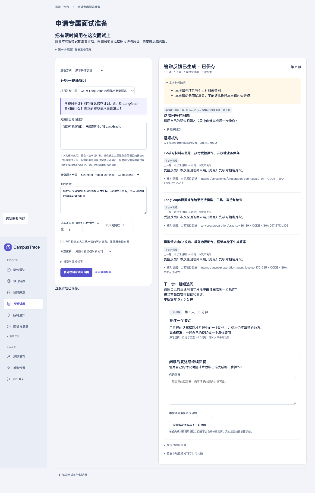

# 申请专属项目答辩：本地实现与受控验收（2026-11-01）

在现有申请准备主链路中增加“练习讲清项目”：用户提交原回答，模型选择主题证据并核对，给出阅读／追问／复述或结束，再把待复习事项经确认保存。首版由用户选定两个主题之一，模型选择主题内证据和下一步，不宣称自主诊断全部岗位能力或扫描任意仓库。

入口：投递进展 → 申请档案 → **练习讲清项目**。主题为 Go／LangGraph 分工，以及模型结果未知后的恢复。[使用、架构和复现命令](../../project-defense.md)。

## 本次实测

| 范围 | 结果及证据 |
| --- | --- |
| Go 编译、vet、全包测试、internal race | 通过；[全包](go-tests.txt)、[race](go-race.txt)、[最终 Agent／评测 CLI 相关 race](targeted-race.txt) |
| 前端 | [465项通过](frontend-summary.txt)，含原回答转义、反馈衔接、四轮边界和前后反馈展示 |
| Python／LangGraph | [4项通过](python-graph.txt)，增加回答核对节点路由；[Docker锁定依赖环境同样通过](docker-python-tests.txt) |
| 既有准备链路 | [24任务×3组＝72条受控结果满足程序预期](preparation-regression.json)，不作为模型质量对照 |
| 新答辩任务 | [20例合成控制](controlled-summary.json)：6调试、14验证，20例满足程序预期；18例完成反馈，2例模拟未知请求暂停。44个脚本化模型回合，6次预设无效调用被拒绝后修正 |
| 实际 Go＋Python＋SQL | [33项产品检查](product-acceptance.json)，其中[答辩专项13项](defense-acceptance.json)：预览零调用、账号隔离、有限证据读取、引文修正、重复启动、复述、5分钟调整、SQL确认回执及重复确认 |
| 浏览器 | [答辩交互11项通过](browser.json)，从申请档案直接进入，核对后提交，复述后保存并刷新；另注入主题接口503，明确失败且不自动切为普通计划 |
| 进程重启 | 答辩的 `unknown-recovery` 场景强杀Python，重开[文件检查点](checkpoint-restart.json)，未授权时拒绝未知调用重试；授权后[完成且代码证据读取仍为1次](recovery-summary.json)。同时保留Go进程重启、取消和旧来源确认拒绝检查 |
| 部署构建 | Go应用镜像、Python preparation镜像构建通过；复用现有服务、锁定依赖和检查点卷，没有新增组件 |

浏览器保存除了页面刷新，还查询对应执行的 MySQL `saved_at` 和唯一确认回执。模拟回答没有修改真实复盘、项目事实或长期记忆。证据版本变更检查使用本轮任务的明确SQL注入，未将其描述为实际滚动发布实验；租约过期同样使用受控注入。

## 实施中发现并修复的问题

- 首次跨进程验收中，借用普通计划schema时，`off`模式移除了检索定义，后续仍按原索引取schema，导致答辩在模型调用前暂停。已在独立schema副本上构造，再发布答辩白名单工具，并把`off`模式加入对应测试。没有回退旧执行器掩盖问题。
- 初次单步测试的夹具将空引用列表编码为`null`，被现有严格JSON校验拒绝。修正夹具为合法空数组，保持产品校验。
- 未分类的初始合成任务文件被既有材料授权检查拦截，在首次请求前停止；补充明确`synthetic-control`分类后才进行受控回归。

这些初始失败与完整本地日志保留在仓库外本轮验收目录。这里保留最终程序证据和失败原因，不把修复过的案例当作真实模型盲测成绩。

## 证据边界与下一步

本轮真实模型请求为0，原评测授权120次调用预算未扩大。模型配置不等于新增调用授权。新的CLI真实评测还要求同时核对任务文件与代码证据包哈希；不匹配时在请求前拒绝。

受控响应使用预设分支，只证明工具循环、错误反馈、预算、状态与提交机制；产品调用配置的`LiveModel`，不会依据测试夹具中的关键词固定判分。引用与核对点绑定、逐字存在并不证明语义充分，模型反馈也不等于用户真正掌握。

最值得继续的一项是小规模真实回答审阅：检查反馈是否误判、是否用正确证据解释缺口、阅读任务能否完成，以及换个问法后是否补上遗漏。未作独立人工标注，未测用户学习收益或检索质量提升。

本轮基于`61aaa56`的未提交工作区，[源码哈希](source-sha256.json)记录实际版本。原有未提交改动保留，本轮未提交或推送；本文不表示GitHub上的功能版本已经更新。
